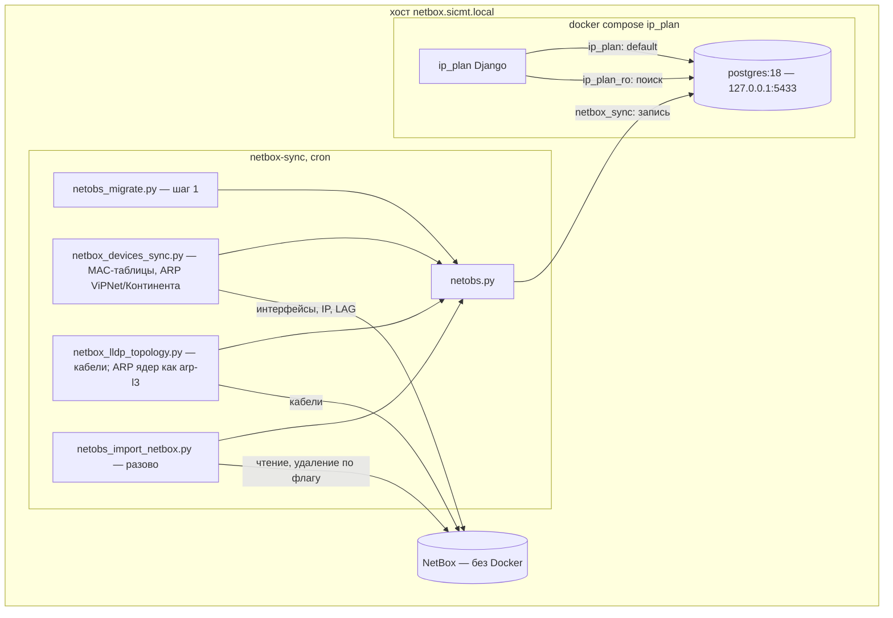
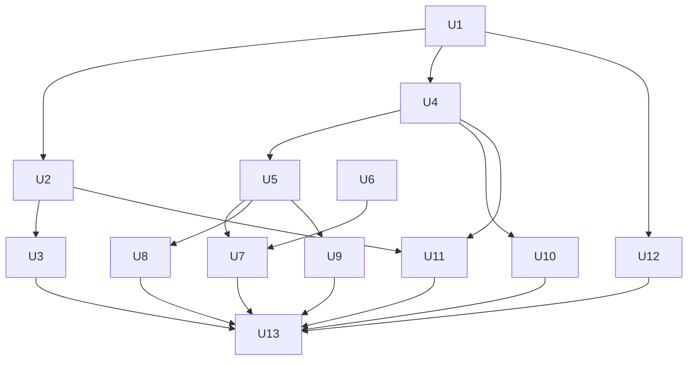

# Хранилище наблюдений вне NetBox и ip_plan на PostgreSQL, этап 1 - Plan

**Целевые репозитории:** `ip_plan_docker_react` (дом этого плана) и `netbox-sync`. Пути без префикса — в `ip_plan_docker_react`; пути с префиксом `netbox-sync/` — в репозитории `netbox-sync`.

---

## Goal Capsule

- **Objective:** операторы видят, где в сети находится MAC или IP, — по истории наблюдений, а не по снимку, переписываемому каждую ночь. NetBox хранит только оборудование и кабели, без шума MAC-таблиц в журнале изменений. Кабели при этом остаются ровно теми же, что сейчас.
- **Means:** наблюдения переносятся в базу `netobs` PostgreSQL рядом с ip_plan, ip_plan переходит на ту же СУБД (KTD1, KTD2).
- **Authority:** дизайн `docs/plans/2026-10-03-observations-store-design.md` → R-ID этого плана → KTD → юниты. При расхождении R побеждает по поведению, KTD — по механизму.
- **Stop conditions:**
  - сверка кабелей до/после даёт необъяснимое расхождение;
  - любой шаг требует менять правила построения связей;
  - в ходе работы обнаружено, что выключатель «`netobs` не настроена» не возвращает прежнее поведение.
- **Execution profile:** два репозитория, у каждого своя ветка; локальное окружение раньше прода; прод — по дням (KTD9).
- **Кто завершает:** реализацию и локальные прогоны — исполнитель; пуш netbox-sync в `main` (это автодеплой на прод), ручной деплой ip_plan и удаление записей из NetBox — только по явному решению пользователя.

---

## Product Contract

### Summary

Новый контейнер `postgres:18` в compose ip_plan хранит две базы:
- `ip_plan` — данные Django;
- `netobs` — наблюдения netbox-sync.

netbox-sync тем же сбором пишет MAC-таблицы и ARP в `netobs` вместо `dcim/mac-addresses` NetBox. Топология читает их оттуда по прежним правилам. ip_plan получает страницу поиска MAC/IP.

Пока `conf/netobs.json` нет, всё работает по-старому. Прод переключается по дням, удаление старых записей из NetBox — отдельное решение после сверки.

### Problem Frame

В локальном NetBox 83% журнала изменений (79 789 из 96 418 записей) — создание и удаление записей `mac-table`/`arp-table`: каждый прогон пересоздаёт около 7,3 тыс. записей. Читает их только `netbox-sync/netbox_lldp_topology.py`. Записи не хранят времени наблюдения, и ревью 02.10.2026 нашло кабель, держащийся на записи трёхмесячной давности.

Этап 2 (SNMP раз в 10 минут) при нынешней схеме дал бы около 1,7 млн записей журнала в сутки. ip_plan при этом сидит на SQLite в одном томе, без бэкапов, а наблюдения нужно читать из двух контейнеров (see origin: docs/plans/2026-10-03-observations-store-design.md).

### Key Decisions

- **NetBox хранит только оборудование, кабели, серверы и ВМ.** MAC-таблицы и ARP уходят в отдельное хранилище с поиском. (session-settled: user-directed — chosen over хранения MAC-таблиц в NetBox: они не нужны в NetBox, если есть поиск в другом месте.) Governs R1, R7.
- **Счётчики интерфейсов и температура — из Zabbix, не собираем.** (session-settled: user-approved — chosen over собственного сбора счётчиков: Zabbix уже опрашивает устройства.) Governs R14.
- **Этап 1 меняет только место хранения.** Сбор и правила связей не меняются, кроме расширения парсеров ARP ради IP. (session-settled: user-directed — chosen over совмещения переноса с переходом на SNMP: сначала перенос, тестирование, отчёт.) Governs R8, R9, R14.
- **Парсеры ARP ViPNet и Континента возвращают и IP**, разбор вывода не меняется. (session-settled: user-directed — chosen over поиска по IP только через ARP ядер: IP с криптошлюзов нужен уже в этапе 1.) Governs R10.
- **Поиск MAC/IP входит в этап 1** и доступен любому вошедшему пользователю. (session-settled: user-directed — chosen over переноса поиска в этап 2: страница сразу помогает проверить данные.) Governs R11, R12.
- **Старые записи из NetBox переносятся; удаление из NetBox — только после сверки кабелей.** (session-settled: user-directed — chosen over удаления без переноса и сохранения в NetBox навсегда.) Governs R6, R7.

### Requirements

**Хранилище и ip_plan**
- R1. ip_plan работает на PostgreSQL, база `ip_plan`, со всеми прежними данными. Прежний SQLite остаётся нетронутым для отката.
- R2. Наблюдения хранятся в базе `netobs` того же экземпляра PostgreSQL. Её схемой владеет netbox-sync.
- R3. PostgreSQL доступен только с хоста (`127.0.0.1`, настраиваемый порт) и из сети compose. Наружу он не открыт.
- R4. Обе базы ежедневно копируются `pg_dump` с ротацией.

**Наблюдения**
- R5. Каждое наблюдение хранит устройство, порт, MAC, при наличии IP, источник, первое и последнее появление. Каждый снятый вывод отражается в журнале опросов: успех, число строк, ошибка.
- R6. Нынешние записи `mac-table`/`arp-table` NetBox переносятся в `netobs` без потерь. Удаление их из NetBox — отдельная команда, необратимая граница.
- R7. После переключения ни один прогон не создаёт и не удаляет записи `dcim/mac-addresses` с description `mac-table`/`arp-table`.

**Синк и топология**
- R8. Сбор MAC-таблиц и ARP идёт теми же командами и парсерами. Меняется только место записи.
- R9. Набор кабелей после переключения совпадает с набором до него, включая старое поведение «порт хранит последний снимок, пропавший порт хранит старые записи». Единственное исключение — пустой вывод источника с полным снимком (Континент) не стирает прежнее содержимое (KTD5); отчёт этапа его отражает.
- R10. Парсеры ARP ViPNet и Континента возвращают пары MAC–IP. Набор MAC на портах остаётся прежним.
- R13. Без `conf/netobs.json` синк и топология работают ровно как сейчас (запись в NetBox). С ним и недоступной базой MAC в NetBox не пишутся, а кабели по таблицам адресов не строятся и не считаются неподтверждёнными.

**Поиск**
- R11. Страница ip_plan находит MAC (целиком или частью не короче 4 hex-символов, в любой из распространённых записей) и IP. Результат: устройство, порт, источник, число адресов за портом, первое и последнее появление.
- R12. Недоступность `netobs` не ломает ip_plan: страница поиска сообщает об этом, остальное работает.

**Границы**
- R14. Не входят: SNMP, VLAN в наблюдениях, правило свежести, LLDP и агрегаты по SNMP, счётчики.

### Success Criteria

- Сверка кабелей и `topology.json` со слепком `research/observations-store/baseline-2026-10-03/` (вне git, рядом с репозиториями) — 0 необъяснённых расхождений.
- Журнал изменений NetBox за полный прогон после переключения — 0 записей `dcim.macaddress` с description `mac-table`/`arp-table`.
- Поиск находит MAC в тех же местах, где его показывала MAC-таблица NetBox до переноса.
- Удаление `conf/netobs.json` возвращает прежнее поведение одним прогоном.

### Scope Boundaries

- Не меняются правила `links_from_address_tables`, LLDP, LACP и подсказок гипервизоров.
- ARP ядер (`arp-l3`) пишется в `netobs` только для поиска и в кабели не попадает: ARP ядер для связей по-прежнему берётся из снимков.
- Синк ip_plan с NetBox и формат `topology.json` не меняются.

#### Deferred to Follow-Up Work

- Этап 2: сбор по SNMP раз в 10 минут, VLAN, правило свежести, отсев посредников по истории, LLDP и агрегаты по SNMP.
- «Что за портом» на карте, сводка свежести опросов, счётчики из Zabbix в ip_plan.
- Владелец MAC по собственным адресам интерфейсов NetBox в выдаче поиска.
- Ротация `poll_runs`/`poll_ports` с сохранением последнего успешного опроса каждого порта, удаление наблюдений исчезнувших портов и устройств, порог возраста последнего успешного опроса — известный долг, понадобится при опросе раз в 10 минут.

### Sources

- Дизайн: `docs/plans/2026-10-03-observations-store-design.md`.
- Ревью построения связей и SNMP-обследование — в корне рабочей директории, вне git: `topology-review-2026-10-02.md`, `snmp-features-2026-10-02.md`.
- postgres:18 — `PGDATA=/var/lib/postgresql/18/docker`, том монтируется на `/var/lib/postgresql` (https://hub.docker.com/_/postgres); образец — `netbox-docker/docker-compose.yml` (соседний каталог).
- Django multi-db и тест-раннер: https://docs.djangoproject.com/en/5.1/topics/db/multi-db/, https://docs.djangoproject.com/en/5.1/topics/testing/advanced/.
- `ALTER DEFAULT PRIVILEGES` действует только на объекты, созданные указанной ролью: https://www.postgresql.org/docs/18/sql-alterdefaultprivileges.html.
- `UNIQUE NULLS NOT DISTINCT`: https://www.postgresql.org/docs/18/sql-createindex.html.

---

## Planning Contract

### Key Technical Decisions

- KTD1. **Две базы в одном контейнере PostgreSQL: `ip_plan` у Django, `netobs` у netbox-sync.** Каждый репозиторий владеет своей схемой, бэкапы раздельные. (session-settled: user-directed — chosen over одной базы с моделями Django для наблюдений и записи через API ip_plan: разделение ответственности и простота отладки.)
- KTD2. **Контейнер `postgres:18` в compose ip_plan, а не системный PostgreSQL боевого NetBox.** (session-settled: user-directed — chosen over отдельной базы в PostgreSQL боевого NetBox: не трогаем боевую СУБД, локально и на проде одинаково.) Порт хоста — переменная, по умолчанию 5433: системный PostgreSQL на проде, вероятно, занимает 5432.
- KTD3. **ip_plan переходит на PostgreSQL в этом этапе.** (session-settled: user-directed — chosen over перевода позже: всё равно предстоит.)
  - Перенос — `dumpdata` без contenttypes, permissions и sessions, затем `migrate` и `loaddata` на пустую базу.
  - Движок выбирает переменная CI `IP_PLAN_DB_ENGINE`, **по умолчанию `sqlite`**. Переключение на `postgres` — только вместе с переносом: иначе любой деплой поднимет `web` на пустой базе, а `ensure_local_admin` создаст `admin`.
  - Откат — смена той же переменной и повторный деплой. Правка `.env` на хосте не годится: CI перезаписывает его при каждом деплое.
- KTD4. **Роли PostgreSQL.**
  - `ip_plan` — владелец базы `ip_plan`, с `CREATEDB` ради тестовой базы Django;
  - `netbox_sync` — владелец базы `netobs`, под ним выполняются все миграции `netobs`;
  - `ip_plan_ro` — только `CONNECT`, `USAGE` и `SELECT`, плюс `ALTER DEFAULT PRIVILEGES FOR ROLE netbox_sync`, чтобы новые таблицы оставались читаемыми; `default_transaction_read_only = on` как вторая защита.

  Роли и базы создаёт идемпотентный скрипт, который работает и на уже существующем томе: init-скрипты образа выполняются только на пустом.
- KTD5. **«Текущее содержимое порта» определяется по опросу, а не по `last_seen` строки.**
  - Все строки одного вывода получают один `last_seen` (время начала опроса) и один `last_run_id`.
  - Порядок опросов — по `poll_runs.started_at`, а не по `id`.
  - Какие порты были в выводе, хранит отдельная таблица `poll_ports` (опрос, порт, число строк). Порт с пустым списком тоже в ней есть, поэтому он очищается, как в старом коде.
  - Текущее для обычного источника — строки последнего успешного опроса, в `poll_ports` которого есть этот порт.
  - Для источника с `complete` (Континент) — строки последнего успешного опроса устройства целиком.
  - Импорт из NetBox — опрос того же источника с отметкой `kind=import` и `started_at` = самое раннее время создания перенесённых записей. Поэтому любой настоящий опрос позже него.

  Это сохраняет старое поведение (R9) и не ломается на импорте, где у каждой записи NetBox своё время создания. Одно сознательное отличие: пустой вывод `complete`-источника не очищает устройство — старый код очищал. (session-settled: user-approved — chosen over точного повторения старой очистки: пустой ответ SNMP чаще сбой, чем реальная пустота, и не должен удалять связи.) Отчёт этапа (U13) отражает его как расхождение.
- KTD6. **Выключатель режима — наличие `conf/netobs.json`.** Нет файла — прежний код записи в NetBox и чтения из NetBox. Есть файл — только `netobs`. Сбой настроенной базы даёт ошибку без обходного пути через NetBox (R13). Откат на проде — переименование файла.
- KTD7. **Миграции `netobs` — отдельный скрипт `netbox-sync/netobs_migrate.py`, первый шаг `full_sync.sh`.** (session-settled: user-directed — chosen over ручного запуска при деплое.) Отдельный скрипт нужен потому, что каждый шаг запускается как `script --env ENV`. Применение — под `pg_advisory_xact_lock`, версии в `schema_version`. Код записи сверяет версию схемы и падает с понятной ошибкой при несовпадении.
- KTD8. **Наблюдение привязывается к NetBox при чтении — по точному имени, как раньше при записи.**
  - Пишутся все порты вывода, включая отсутствующие в NetBox: они полезны поиску.
  - Топология сопоставляет порт с интерфейсом NetBox **с учётом регистра**, как делал `iface_map[name]` при записи. Иначе порт, раньше отброшенный из-за регистра, мог бы дать новый кабель.
  - `nb_device` — ровно то имя устройства в NetBox, к которому старый код привязывал запись. Число несопоставленных наблюдений по устройствам печатается в сводке.
  - Отсев устройств с выключенным `sync_macs` — по имени устройства NetBox, как сейчас; ноды ViPNet не отсеиваются.
- KTD9. **Прод переключается по дням**, порядок — в Operational / Rollout Notes.
  - день 0: накопленные с 30.09 коммиты netbox-sync выкатываются отдельно и наблюдаются одну ночь, чтобы сбой этапа не смешался с ними;
  - день 1: PostgreSQL и бэкапы, затем перенос ip_plan;
  - день 2: код netbox-sync в `main`, `conf/netobs.json`, миграция, импорт и сверка;
  - позже: удаление из NetBox — по критериям go/no-go и отдельному решению.

  Код netbox-sync живёт в ветке до дня 2, потому что пуш в `main` — это автодеплой. Мерж без `conf/netobs.json` безопасен: шаг миграции выходит с кодом 0, синк работает по-старому.
- KTD10. **Запись в `netobs` из пулов потоков — соединение на поток, транзакция на вывод.**
  - Внутри транзакции — advisory lock на пару (устройство, источник): ручной запуск и ночной прогон не смешают два опроса в одном порту.
  - Обновление строки — только если её `last_seen` не новее записываемого; строки вставляются в отсортированном порядке.
  - Запись ошибки в `poll_runs` — отдельной транзакцией, чтобы откат её не стёр.
  - Ключ уникальности — `UNIQUE NULLS NOT DISTINCT (nb_device, interface, vlan, mac, ip, source)`: за одним MAC на порту бывает много IP (маршрутизатор, NAT — в ARP ядра офиса до 97), и без `ip` в ключе поиск по IP потерял бы почти все. Дубли внутри пачки убираются по тому же ключу до вставки.
  - Чтение «текущего» — одним снимком (`REPEATABLE READ READ ONLY`).
- KTD11. **Поиск — сырой SQL через подключение `netobs` под `ip_plan_ro`, без моделей Django.**
  - маршрутизатор запрещает миграции и запись в `netobs`;
  - соединение с `connect_timeout` и `statement_timeout`, выдача ограничена;
  - ввод — только параметрами;
  - тесты страницы мокают сервисный слой: схема `netobs` принадлежит другому репозиторию.

### High-Level Technical Design

Компоненты и потоки данных:



Режимы записи MAC-таблиц (KTD6):

| `conf/netobs.json` | База | Куда пишутся MAC-таблицы и ARP | Правило «таблица адресов» в топологии | Отчёт «без подтверждения» |
|---|---|---|---|---|
| нет | — | NetBox, как сейчас | из NetBox | как сейчас |
| есть | доступна, схема актуальна | `netobs` | из `netobs` | как сейчас |
| есть | недоступна или схема устарела | никуда, `ERROR` по устройству | пропускается, `WARN` | кабели `MAC-таблица`, `ARP`, `MAC-таблица + ARP` исключены, их история переносится без изменений |

«Текущее содержимое порта» (KTD5), направляющий набросок, не спецификация:

```text
порядок опросов:   по poll_runs.started_at; импорт — самый ранний
обычный источник:  для каждого (устройство, порт, источник)
                   взять последний по started_at успешный опрос,
                   в poll_ports которого есть этот порт
                   → строки этого опроса (пустой список = порт пуст)
complete-источник: для каждого (устройство, источник)
                   взять последний успешный опрос устройства, включая импорт
                   → все его строки; порты вне опроса — пусто
неуспешный опрос:  не меняет текущего
пустой вывод:      не считается успешным опросом complete-источника
```

### Assumptions

- Системный PostgreSQL боевого NetBox на проде слушает `127.0.0.1:5432` — отсюда порт по умолчанию 5433. Проверить на хосте до дня 1.
- Django 5.1.4 официально тестировался с PostgreSQL до 17. С 18 ожидается совместимость: используются только базовые возможности, проверяется полным прогоном тестов ip_plan.
- На хосте прода для `psycopg[binary]` есть колесо под его Python. `full_sync.sh` ставит зависимости сам (`pip install -r requirements.txt`).

### Sequencing

- **Предусловие:** незакоммиченная работа пользователя в обоих репозиториях закоммичена локально, без пуша, до создания веток. Иначе ветки возьмут код без неё: `eltex_mes24.py`, правки `netbox_devices_sync.py` и `netbox_lldp_topology.py`.
- Сначала инфраструктура: U1 → U2 → U3.
- Затем схема и библиотека: U4 → U5.
- Дальше направления A (ip_plan: U11, U12) и B (netbox-sync: U6, U7, U8, U9, U10) идут параллельно; общая точка — схема из U4.
- Документация и отчёт — U13, последним.



---

## Implementation Units

| U-ID | Что | Основные файлы | Зависит от |
|---|---|---|---|
| U1 | PostgreSQL в compose, роли и базы | `docker-compose.yml`, `db/bootstrap.sh`, `.env.example`, `.gitlab-ci.yml` | — |
| U2 | ip_plan на PostgreSQL | `config/settings.py`, `entrypoint.sh`, `requirements.txt`, `ip_plan/services/connection_test.py` | U1 |
| U3 | Перенос данных SQLite → PostgreSQL | `scripts/sqlite_to_postgres.sh`, `ip_plan/management/commands/db_counts.py` | U2 |
| U4 | Схема `netobs` и миграции | `netbox-sync/netobs.py`, `netbox-sync/netobs/migrations/0001_init.sql`, `netbox-sync/netobs_migrate.py` | U1 |
| U5 | Запись и чтение наблюдений | `netbox-sync/netobs.py` | U4 |
| U6 | IP в парсерах ARP | `netbox-sync/netbox_devices_sync.py`, `netbox-sync/netbox_continent_snmp.py` | — |
| U7 | Синк устройств пишет в `netobs` | `netbox-sync/netbox_devices_sync.py` | U5, U6 |
| U8 | Топология читает `netobs` | `netbox-sync/netbox_lldp_topology.py` | U5 |
| U9 | Импорт из NetBox и удаление по флагу | `netbox-sync/netobs_import_netbox.py` | U5 |
| U10 | Шаг миграции в `full_sync.sh` и в ip_plan | `netbox-sync/full_sync.sh`, `ip_plan/services/sync_log.py` | U4 |
| U11 | Страница поиска MAC/IP | `ip_plan/db_routers.py`, `ip_plan/services/netobs_search.py`, `ip_plan/views_obs.py` | U2, U4 |
| U12 | Бэкапы PostgreSQL | `scripts/pg_backup.sh` | U1 |
| U13 | Документация и отчёт этапа | `CLAUDE.md`, `netbox-sync/CLAUDE.md`, `DEPLOY_CHECKLIST.md` | все |

### U1. PostgreSQL в compose ip_plan, роли и базы

- **Goal:** поднять `postgres:18` с базами `ip_plan` и `netobs` и тремя ролями, доступный только с хоста и из compose.
- **Requirements:** R2, R3; KTD1, KTD2, KTD4.
- **Dependencies:** нет.
- **Files:** `docker-compose.yml`, `db/bootstrap.sh` (новый), `.env.example`, `.gitlab-ci.yml`, `ip_plan/tests/test_compose_postgres.py` (новый).
- **Approach:**
  1. Сервис `postgres`:
     - том `pg_data` на `/var/lib/postgresql` — не `/data`, так требует образ 18;
     - `ports: 127.0.0.1:${POSTGRES_HOST_PORT:-5433}:5432`;
     - healthcheck `pg_isready`, `restart: unless-stopped`;
     - `web` зависит от него с `condition: service_healthy`.
  2. `db/bootstrap.sh` идемпотентно создаёт роли и базы, назначает права по KTD4. Его вызывают init-скрипт образа (пустой том) и ручная команда (существующий том). Пароли ролей — из переменных окружения.
  3. Секреты разделены по сервисам:
     - отдельный `.env.db` (подключён `env_file` только к `postgres`): `POSTGRES_PASSWORD`, пароли ролей для bootstrap, включая `NETBOX_SYNC_DB_PASSWORD`;
     - `.env` для `web`: только `IP_PLAN_DB_*` и `NETOBS_RO_*` — веб-приложение не держит пароли суперпользователя и владельца `netobs`.

     Оба файла — в примерах и в шаблонах `.gitlab-ci.yml`. Без них прод перепишет файлы неполными.
  4. Том `sqlite_data` остаётся смонтированным: он нужен для переноса и отката.
- **Patterns to follow:** `netbox-docker/docker-compose.yml` (сервис postgres, healthcheck), публикация на loopback как у `guacamole` в `docker-compose.yml`, блоки с комментариями в `.env.example`.
- **Test scenarios:**
  - повторный запуск `bootstrap.sh` на уже настроенном томе ничего не меняет и не падает;
  - под `ip_plan_ro` создание таблицы в `netobs` отклоняется;
  - таблица, созданная ролью `netbox_sync` после bootstrap, читается под `ip_plan_ro` (проверка default privileges);
  - порт хоста недоступен с внешнего интерфейса: публикация только на `127.0.0.1`;
  - в окружении контейнера `web` нет `POSTGRES_PASSWORD` и `NETBOX_SYNC_DB_PASSWORD`.
- **Execution note:** конфигурация; основное доказательство — smoke-проверка на живом compose, а не юнит-тесты.
- **Verification:** `docker compose up` поднимает `postgres` в состоянии healthy, все три роли подключаются к своим базам с ожидаемыми правами.

### U2. ip_plan работает на PostgreSQL

- **Goal:** переключить `DATABASES["default"]` на PostgreSQL с сохранением возможности отката на SQLite.
- **Requirements:** R1, R12; KTD3.
- **Dependencies:** U1.
- **Files:** `config/settings.py`, `entrypoint.sh`, `requirements.txt`, `ip_plan/services/connection_test.py`, `ip_plan/tests/test_db_settings.py` (новый).
- **Approach:**
  1. `IP_PLAN_DB_ENGINE=sqlite|postgres` через `decouple`, по умолчанию `sqlite` (KTD3); хост, порт и учётные данные — из окружения (внутри compose `postgres:5432`, с хоста `127.0.0.1:<порт>`). Переменная и `SEED_LOCAL_ADMIN` добавляются в шаблон `.env` в `.gitlab-ci.yml`.
  2. `psycopg[binary]` в `requirements.txt` с комментарием-обоснованием, как принято в файле.
  3. `entrypoint.sh` перед `migrate` ждёт готовности базы, иначе при рестарте хоста `web` падает в цикл.
  4. Фоновый поток проверки подключения закрывает соединение с базой в `finally`: на PostgreSQL каждый поток держит своё соединение.
  5. Комментарии «SQLite не проверяет длину» и абзацы про SQLite в коде обновляются по месту: `views.py`, `models.py`, `services/secretbox.py`, `services/settings_bundle.py`.
- **Patterns to follow:** идиома `config("X", default="") or <дефолт>` в `config/settings.py`.
- **Test scenarios:**
  - без переменной движок — прежний SQLite с путём `data/db.sqlite3`;
  - `IP_PLAN_DB_ENGINE=postgres` даёт PostgreSQL с параметрами из окружения;
  - весь набор тестов `ip_plan` проходит на PostgreSQL;
  - поток проверки подключения после завершения не оставляет открытого соединения.
- **Verification:** ip_plan стартует на пустой базе PostgreSQL, `migrate` проходит, все тесты зелёные.

### U3. Перенос данных SQLite → PostgreSQL

- **Goal:** повторяемая процедура переноса с проверкой полноты.
- **Requirements:** R1; KTD3.
- **Dependencies:** U2.
- **Files:** `scripts/sqlite_to_postgres.sh` (новый), `ip_plan/management/commands/db_counts.py` (новый), `ip_plan/tests/test_db_counts.py` (новый).
- **Approach:**
  1. Предусловия, при нарушении скрипт останавливается:
     - схема SQLite на той же версии миграций, что код;
     - целевая база пуста, кроме строк, засеянных миграциями;
     - в SQLite нет строк длиннее `max_length`, NUL-символов и значений неверного типа: SQLite их принимает, а `loaddata` откатится целиком.
  2. Остановить `web`, скопировать файл SQLite, выполнить `dumpdata --natural-foreign --natural-primary` без `contenttypes`, `auth.permission`, `sessions`, `admin.logentry`.
  3. `migrate` на PostgreSQL с `SEED_LOCAL_ADMIN=false`.
  4. Удаление засеянных строк (`0003` — имена объектов xFW, `0008` — синглтон LDAP) и `loaddata` — в одной транзакции, иначе при сбое останется пустой `LdapConfig`.
  5. Выполнить SQL, который печатает `sqlsequencereset`: сама команда только печатает его.
  6. Проверки:
     - `db_counts` по каждой модели для обеих баз совпадает;
     - пароль LDAP расшифровывается — тот же `SECRET_KEY`, иначе стоп;
     - у каждой `LocalAccount` и `MapLayout` есть пользователь.
  7. Только после этого `IP_PLAN_DB_ENGINE=postgres` и старт `web`. Файл SQLite больше не используется и не изменяется, права на него не меняются — это источник отката. Выгрузка `dumpdata` переноса сохраняется: по ней откат проверяет, писалось ли что-то после переключения.
  8. Обратный перенос PostgreSQL → SQLite — тот же скрипт в обратную сторону. Это путь отката, если после переключения были записи.
  9. Сессии не переносятся: пользователи входят заново.
- **Execution note:** сначала прогнать на копии боевого файла SQLite, затем на рабочем.
- **Test scenarios:**
  - `db_counts` выводит одинаковые числа для двух баз с одинаковыми данными и указывает модель с расхождением;
  - после переноса создание записи в каждой модели не падает на дубле первичного ключа (последовательности сброшены);
  - пароль LDAP после переноса расшифровывается;
  - имена объектов xFW и настройки LDAP после переноса равны значениям из SQLite, а не засеянным;
  - непустая целевая база (лишний `admin`) — скрипт отказывается работать;
  - строка длиннее `max_length` в SQLite — скрипт останавливается на предпроверке, PostgreSQL не тронут.
- **Verification:** числа строк совпадают по всем моделям; вход по LDAP и по локальной учётке, реестр, настройки и карта работают.

### U4. Схема `netobs` и миграции

- **Goal:** база `netobs` получает схему наблюдений, применяемую идемпотентно и безопасно при параллельном запуске.
- **Requirements:** R2, R5; KTD5, KTD7, KTD10.
- **Dependencies:** U1.
- **Files:** `netbox-sync/netobs.py` (новый), `netbox-sync/netobs/migrations/0001_init.sql` (новый), `netbox-sync/netobs_migrate.py` (новый), `netbox-sync/conf/netobs.example.json` (новый), `netbox-sync/.gitignore`, `netbox-sync/.gitlab-ci.yml`, `netbox-sync/requirements.txt`, `netbox-sync/tests/test_netobs.py` (новый).
- **Approach:**
  1. `0001_init.sql`:
     - `schema_version`;
     - `poll_runs(id, nb_device, sync_key, source, kind, complete, started_at, finished_at, ok, rows, error)`, `kind` — `poll` или `import`;
     - `poll_ports(run_id, interface, rows)` — порты, бывшие в выводе (KTD5);
     - `observations(id, nb_device, sync_key, interface, vlan, mac macaddr, ip inet, source, first_seen, last_seen, seen_count, last_run_id)` с ключом по KTD10, `first_seen` допускает NULL;
     - представление `current_observations` — правила KTD5 в SQL, одно определение для топологии и поиска ip_plan;
     - индексы по `mac`, `ip`, `(nb_device, interface, source, last_run_id)`, `poll_runs(nb_device, source, ok, started_at DESC)`;
     - `GRANT SELECT` для `ip_plan_ro` на таблицы и представление.
  2. `netobs.py` без побочных эффектов при импорте:
     - чтение `conf/netobs.json` через `conf_loader` с наложением по `--env`, как в `config.json`;
     - `configured()`, `connect()`, `migrate()` под advisory lock, `schema_ok()` — ложно и при версии ниже, и при версии выше поддерживаемой (откат кода после новой миграции).
  3. Миграции — только транзакционные операции (без `CREATE INDEX CONCURRENTLY`).
  4. `netobs_migrate.py --env ENV`: нет конфигурации — сообщает и выходит с кодом 0; есть — применяет миграции, при ошибке возвращает ненулевой код.
  5. `conf/netobs.json` — в `.gitignore` и в исключения rsync в `.gitlab-ci.yml`.
- **Patterns to follow:** `conf/config.example.json` (секции `environments`), поимённые исключения в `.gitignore` и `.gitlab-ci.yml` (как `ssh_access.json`), закреплённые версии с комментарием в `requirements.txt`.
- **Test scenarios** (на тестовой базе PostgreSQL, без неё модуль пропускается):
  - миграции на пустой базе создают все таблицы и записывают версию;
  - повторный `migrate()` ничего не делает;
  - два параллельных `migrate()` не применяют одну миграцию дважды;
  - `schema_ok()` ложно при версии ниже ожидаемой и при версии выше поддерживаемой;
  - вставка двух строк с одинаковым ключом и `vlan = NULL` отклоняется уникальным индексом;
  - `netobs_migrate.py` без `conf/netobs.json` завершается с кодом 0 и сообщением.
- **Verification:** `netobs_migrate.py --env local` создаёт схему; под `ip_plan_ro` таблицы читаются.

### U5. Запись и чтение наблюдений

- **Goal:** API записи вывода как одного опроса и чтения «текущего содержимого портов» по старым правилам.
- **Requirements:** R5, R9; KTD5, KTD10.
- **Dependencies:** U4.
- **Files:** `netbox-sync/netobs.py`, `netbox-sync/tests/test_netobs.py`.
- **Approach:**
  1. `record_output(nb_device, sync_key, source, rows_by_port, complete)`, одна транзакция:
     - advisory lock на (устройство, источник);
     - строка `poll_runs` и строки `poll_ports` для всех портов вывода, включая пустые;
     - upsert строк с `last_seen = started_at` и `last_run_id`, условный по `last_seen` (KTD10);
     - `seen_count + 1`, `first_seen` не трогается у существующих строк.
  2. Ошибка записывается в `poll_runs` отдельной транзакцией. Пустой вывод `complete`-источника успешным опросом не считается.
  3. Соединение — на поток (KTD10). MAC нормализуется к одному виду на записи; при чтении отдаётся в виде, который ждёт топология (12 hex).
  4. `current_observations()` читает одноимённое представление одним снимком. Преобразование строк в структуру «порт → {MAC: источник}» — чистая функция, проверяемая без базы; строки с одним MAC и разными IP сворачиваются в один MAC.
- **Execution note:** реализовать тест-первым — правила «текущего» и есть контракт сверки 1:1.
- **Test scenarios:**
  - повторная запись того же вывода обновляет `last_seen` и `seen_count`, не создавая строк;
  - порт, пропавший из следующего вывода, сохраняет прежние строки как текущие (старое поведение);
  - порт, в следующем выводе с другим набором MAC, отдаёт только новый набор;
  - порт, в следующем выводе с пустым списком, становится пустым (как старый код);
  - опрос, начатый раньше, но записанный позже, не становится текущим поверх более нового;
  - два одновременных `record_output` одного устройства и источника выполняются по очереди, не смешивая строки;
  - `complete`-источник: порт, пропавший из следующего успешного опроса, становится пустым;
  - неуспешный опрос `complete`-источника не меняет текущего;
  - пустой вывод `complete`-источника не очищает текущее;
  - сбой посреди записи оставляет ни одной новой строки и запись об ошибке в `poll_runs`;
  - дубль MAC внутри одного вывода (разные VLAN в исходной таблице) даёт одну строку;
  - один MAC с двумя IP на одном порту даёт две строки, а чистая функция для топологии — один MAC;
  - строки двух устройств, записанные из разных потоков одновременно, не смешиваются;
  - чистая функция преобразования отдаёт ту же структуру, что строил `NetBoxIndex.observed` из записей NetBox.
- **Verification:** все сценарии зелёные на тестовой базе.

### U6. IP в парсерах ARP

- **Goal:** парсеры ARP ViPNet и Континента возвращают пары MAC–IP при неизменном наборе MAC.
- **Requirements:** R10; Key Decision «Парсеры ARP…».
- **Dependencies:** нет.
- **Files:** `netbox-sync/netbox_devices_sync.py` (`parse_vipnet_arp`), `netbox-sync/netbox_continent_snmp.py` (`arp_by_iface`), `netbox-sync/tests/test_mac_tables.py`, `netbox-sync/tests/test_continent_snmp.py`.
- **Approach:**
  1. Разбор строк не меняется: регулярка ViPNet уже захватывает IP, у Континента IP есть в индексе `ipNetToMediaTable`.
  2. Форма результата — «порт → список пар (MAC, IP)». Все прежние потребители получают тот же набор MAC через одну функцию-адаптер, чтобы старый путь записи в NetBox не менялся.
- **Execution note:** сначала зафиксировать характеризационным тестом нынешний набор MAC на существующих фикстурах, потом менять форму.
- **Test scenarios:**
  - на фикстуре `vipnet_arp_table.txt` набор MAC по портам совпадает с прежним;
  - на той же фикстуре у каждой записи есть IP из вывода;
  - строки `(incomplete)` по-прежнему отбрасываются;
  - у Континента собственные и статические записи по-прежнему исключены, IP соответствует индексу таблицы.
- **Verification:** прежние тесты парсеров зелёные без изменения ожидаемых MAC; новые проверяют IP.

### U7. Синк устройств пишет в `netobs`

- **Goal:** при настроенной `netobs` MAC-таблицы и ARP пишутся туда, иначе — по-старому в NetBox.
- **Requirements:** R7, R8, R13; KTD6, KTD8, KTD10.
- **Dependencies:** U5, U6.
- **Files:** `netbox-sync/netbox_devices_sync.py` (`_store_mac_table` и семь мест вызова), `netbox-sync/tests/test_store_mac_table.py` (новый).
- **Approach:**
  1. `_store_mac_table` получает `nb_device` и `sync_key`: у обычных устройств это `dev_name`, у нод ViPNet — `name` ноды и `sync_key` записи.
  2. `netobs.configured()` → запись через `record_output`, иначе прежний код целиком.
  3. При настроенной, но недоступной или устаревшей базе — `ERROR netobs: …` по устройству, в NetBox ничего.
  4. Пишутся все порты вывода, включая отсутствующие в NetBox (KTD8). Флаг `complete` передаётся как есть.
  5. Теневой режим только для local (`NETOBS_SHADOW=1` в окружении прогона): один и тот же разобранный вывод пишется и в NetBox прежним кодом, и в `netobs`. Режим нужен для сверки ночного пути записи со старым кодом (Verification Contract) и на проде не используется.
- **Patterns to follow:** буферизованный вывод `out()` по потокам, формат строк `MACs: deleted=… added=…` (новый — `netobs: rows=… run=…`).
- **Test scenarios:**
  - без конфигурации вызывается прежний путь записи в NetBox (проверка моком NetBox-клиента);
  - с конфигурацией `record_output` получает те же порты и MAC, а NetBox не вызывается;
  - нода ViPNet пишется под своим именем и `sync_key` кластера;
  - недоступная база: строка `ERROR` в выводе устройства, NetBox не вызывается, синк интерфейсов продолжает работу.
- **Verification:** прогон шага устройств с `conf/netobs.json` на **отдельной временной базе** (не рабочей локальной `netobs`) даёт строки в ней и 0 новых записей `dcim.macaddress`. Рабочая локальная `netobs` получает первый настоящий опрос только после импорта и сверки, иначе импорт и сверка потеряют смысл.

### U8. Топология читает наблюдения из `netobs`

- **Goal:** правило «таблица адресов» строит те же кабели из `netobs`. ARP ядер сохраняется для поиска.
- **Requirements:** R9, R13; KTD5, KTD6, KTD8.
- **Dependencies:** U5.
- **Files:** `netbox-sync/netbox_lldp_topology.py` (`NetBoxIndex`, `collect_device`, `main`), `netbox-sync/tests/test_topology_links.py`, `netbox-sync/tests/test_topology_netobs.py` (новый).
- **Approach:**
  1. `NetBoxIndex.observed` строится из `current_observations()` через сопоставление (имя устройства, точное имя порта) с интерфейсами индекса (KTD8). Источники `mac-table` и `arp-table` — как сейчас. `muted` — по имени устройства NetBox, как сейчас. Сводка печатает число несопоставленных наблюдений по устройствам.
  2. Без конфигурации — прежнее чтение `dcim/mac-addresses`.
  3. `collect_device` пишет ARP ядра как `arp-l3`, кроме режимов `DRY_RUN` и `RAW_DIR`. `arp-l3` не входит в `ADDRESS_TABLE_SOURCES`.
  4. Недоступная база (таблица режимов в Planning Contract):
     - правило пропускается с `WARN`;
     - кабели трёх источников по таблицам адресов исключаются из списка неподтверждённых;
     - их записи в истории `unconfirmed_cables.json` переносятся без изменения счётчиков.
  5. В теневом режиме (U7) `observed` строится обоими способами — из NetBox и из `netobs`, а разница по портам печатается.
- **Test scenarios:**
  - на одинаковых данных структура `observed` из `netobs` совпадает со структурой из записей NetBox;
  - наблюдение за портом, которого нет в NetBox, в `observed` не попадает;
  - порт, отличающийся от интерфейса NetBox только регистром, в `observed` не попадает (как старый `skipped`);
  - теневой режим на одинаковых данных печатает пустую разницу, а при подмешанном лишнем MAC в `netobs` — этот порт;
  - устройство с выключенным `sync_macs` отсеивается, нода ViPNet — нет;
  - недоступная база: `links_from_address_tables` не вызывается, кабели `MAC-таблица`/`ARP` не попадают в «без подтверждения», их `runs` и `since` в истории не меняются;
  - `arp-l3` пишется при обычном прогоне и не пишется при `--dry-run`;
  - существующие тесты правил отсева остаются зелёными.
- **Verification:** прогон топологии по копии снимков на импортированных данных даёт тот же набор кабелей, что слепок.

### U9. Импорт из NetBox и удаление по флагу

- **Goal:** перенести записи `mac-table`/`arp-table` в `netobs`; удаление из NetBox — отдельная защищённая команда.
- **Requirements:** R6, R7; Key Decision «Старые записи…».
- **Dependencies:** U5.
- **Files:** `netbox-sync/netobs_import_netbox.py` (новый), `netbox-sync/tests/test_netobs_import.py` (новый), `netbox-sync/tests/fixtures/netbox_mac_records.json` (новый).
- **Approach:**
  1. Режим по умолчанию: чтение записей NetBox и запись одним опросом `kind=import` на устройство и источник (KTD5), с `poll_ports` по портам записей. `started_at` опроса — самое раннее время создания его записей; у строк `last_seen` — время создания записи, `first_seen` пуст.
  2. Только вставка отсутствующих ключей, без обновления существующих строк. Порядок опросов задаёт KTD5, поэтому импорт после настоящего опроса текущего не меняет.
  3. `--dry-run` печатает план.
  4. `--delete-from-netbox`:
     - отказ, пока у каждого устройства импорта нет хотя бы одного настоящего успешного опроса; устройство, которое больше не опрашивается, исключается явным списком в аргументе команды, и его записи не удаляются;
     - пара записи — точный ключ (устройство, порт, MAC, источник); отказ, если хотя бы у одной записи её нет;
     - сначала выгрузка удаляемых записей в JSON со всеми полями, затем удаление строго по списку `id` из выгрузки, с повторной проверкой `description` и типа объекта перед каждым удалением;
     - печать числа удалённых. `--force` только для локального окружения.
  5. Восстановления из выгрузки нет: после удаления MAC-таблицы в NetBox возвращает только прогон в старом режиме (Risk Analysis).
- **Test scenarios:**
  - импорт фикстуры создаёт по строке на уникальную пару (порт, MAC, источник);
  - дубли одного MAC на порту из-за разных VLAN схлопываются в одну строку;
  - повторный импорт не меняет число строк;
  - после импорта `current_observations()` отдаёт то же содержимое портов, что записи NetBox;
  - импорт после настоящего опроса не меняет текущего содержимого портов;
  - тот же MAC на другом порту не считается парой для удаления;
  - `--delete-from-netbox` без пары в `netobs` отказывает и ничего не удаляет;
  - `--delete-from-netbox` до первого настоящего опроса устройства отказывает;
  - `--delete-from-netbox` сначала пишет файл выгрузки и удаляет только `id` из него (проверка моком);
  - запись с другим `description`, оказавшаяся в списке, не удаляется.
- **Verification:** локальный импорт переносит 6 114 `mac-table` и 1 222 `arp-table` с учётом схлопнутых дублей; сверка кабелей проходит (Verification Contract).

### U10. Шаг миграции в `full_sync.sh` и в ip_plan

- **Goal:** миграции `netobs` выполняются первым шагом прогона, и ip_plan показывает этот шаг в сводке.
- **Requirements:** R2; KTD7.
- **Dependencies:** U4.
- **Files:** `netbox-sync/full_sync.sh`, `ip_plan/services/sync_log.py`, `ip_plan/tests/test_settings.py`.
- **Approach:**
  1. «Netobs migrate» / `netobs_migrate.py` — первые элементы `STEP_NAMES` и `STEP_SCRIPTS`; проверка длин уже есть. Шапка-комментарий файла обновляется.
  2. `STEPS` в `sync_log.py` — та же запись с описанием.
  3. Позиционные допущения в `test_settings.py` (`STEP_NAMES[:9]`, индекс шага «Config backup») обновляются.
- **Test scenarios:**
  - тест соответствия `STEPS` и `full_sync.sh` находит новый шаг;
  - позиционные проверки шагов проходят после сдвига.
- **Verification:** локальный `full_sync.sh` печатает новый шаг первым; сводка ip_plan показывает его статус.

### U11. Страница поиска MAC/IP

- **Goal:** любой вошедший пользователь находит, где виден MAC или IP.
- **Requirements:** R11, R12; KTD11.
- **Dependencies:** U2, U4.
- **Files:** `config/settings.py` (`DATABASES["netobs"]`, `DATABASE_ROUTERS`), `ip_plan/db_routers.py` (новый), `ip_plan/services/netobs_search.py` (новый), `ip_plan/views_obs.py` (новый), `ip_plan/urls.py`, `ip_plan/templates/ip_plan/obs_search.html` (новый), `ip_plan/templates/ip_plan/base.html`, `ip_plan/context_processors.py`, `static/ip_plan/css/obs.css` (новый), `ip_plan/tests/test_obs_search.py` (новый), `ip_plan/tests/test_db_routers.py` (новый).
- **Approach:**
  1. Подключение `netobs` — роль `ip_plan_ro`, `connect_timeout` 3 с, `statement_timeout` 5 с.
  2. Маршрутизатор: миграции — только `default`, запись в `netobs` запрещена.
  3. Разбор ввода — в сервисе:
     - полный MAC в любых записях (`aa:bb:…`, `aabb.ccdd.eeff`, `AA-BB-…`, 12 hex);
     - часть MAC от 4 hex — по префиксу и подстроке, с экранированием `%` и `_`;
     - IP — точное совпадение;
     - иначе — понятная ошибка ввода.
  4. IP ищется по `arp-table` и `arp-l3`, затем по найденным MAC.
  5. Выдача:
     - лимит 200 и «показано N из M»;
     - колонки: MAC, IP (пусто без ARP), устройство, порт, источник, число адресов за портом, состояние, первое и последнее появление;
     - состояние — «текущее» по представлению `current_observations` (U4) или «прежнее»; число адресов за портом считается по текущим строкам; прежние и импортированные строки приглушены;
     - `last_seen` — относительный возраст с датой в подсказке; пустой `first_seen` — «до переноса»;
     - сортировка: текущие строки первыми, внутри — порты с меньшим числом адресов (вероятный порт подключения), затем по `last_seen`; подпись над таблицей объясняет этот порядок.
  6. Состояния страницы:
     - начальное — поле ввода и примеры форматов MAC и IP;
     - пусто для MAC — «не встречался в таблицах опрошенных устройств» с временем последнего успешного опроса;
     - данных нет совсем (ни одного успешного опроса) — «опросы ещё не выполнялись»;
     - IP без ARP, ошибка ввода, недоступная база — как в сценариях ниже.
  7. Поиск идёт по всем площадкам независимо от переключателя площадки в шапке: адрес ищут по всей сети. Пункт меню и заголовок — «Поиск MAC/IP», префикс `obs_`.
- **Patterns to follow:** `acl_lookup`/`acl_where` в `ip_plan/views.py` и сервис с `QueryError` в `ip_plan/services/acl_search.py`, пункт меню и `_SECTION_TITLES`.
- **Test scenarios:**
  - все четыре записи одного MAC дают один и тот же запрос к сервису;
  - часть MAC из 3 hex отклоняется с понятной ошибкой;
  - ввод с `%` или `_` не превращается в шаблон;
  - IP без ARP-записи — пустой результат с пояснением «для этого IP нет ARP-записей»;
  - больше 200 совпадений — 200 строк и «показано 200 из M»;
  - MAC, переехавший на другой порт, показан на новом порту как «текущее», на старом — как «прежнее»;
  - поиск по IP, за которым в ARP ядра стоит общий MAC с другими IP, находит именно этот IP;
  - при пустой базе без опросов страница пишет «опросы ещё не выполнялись», а не «не найдено»;
  - недоступная `netobs` (мок исключения подключения) — страница отвечает 200 с сообщением, а не 500;
  - маршрутизатор: `allow_migrate` ложен для `netobs`, `db_for_write` никогда не возвращает `netobs`;
  - страница без входа перенаправляет на логин.
- **Verification:** на локальных данных поиск находит MAC `90:54:b7:34:06:c0` (np1) за теми же портами, где его показывала MAC-таблица NetBox.

### U12. Бэкапы PostgreSQL

- **Goal:** ежедневная копия обеих баз и ролей с ротацией.
- **Requirements:** R4.
- **Dependencies:** U1.
- **Files:** `scripts/pg_backup.sh` (новый), `DEPLOY_CHECKLIST.md`.
- **Approach:**
  1. `pg_dump -Fc` по каждой базе и `pg_dumpall --globals-only` через `docker compose exec -T` в каталог на хосте вне тома.
  2. Ротация — 14 дней.
  3. Запуск — cron хоста; строка cron и проверка восстановления описаны в `DEPLOY_CHECKLIST.md`.
- **Execution note:** операционный скрипт; доказательство — восстановление дампа в отдельный временный контейнер.
- **Test expectation:** none — скрипт обёртки над `pg_dump`, проверяется восстановлением.
- **Verification:** дамп за вчера восстанавливается в чистый контейнер, `db_counts` совпадает.

### U13. Документация и отчёт этапа

- **Goal:** документация отражает новое хранилище; отчёт фиксирует итоги этапа 1.
- **Requirements:** R1–R14.
- **Dependencies:** все.
- **Files:** `CLAUDE.md`, `DEPLOY_CHECKLIST.md`, `netbox-sync/CLAUDE.md`, `docs/plans/<дата>-observations-store-report.md` (новый).
- **Approach:**
  1. ip_plan `CLAUDE.md`: архитектура (PostgreSQL вместо SQLite), запуск локально, таблица `.env`, страница поиска.
  2. `netbox-sync/CLAUDE.md`:
     - раздел «Хранилище наблюдений `netobs`» из «в работе» становится описанием;
     - разделы «Таблицы MAC», «Как строятся связи», «Тесты» обновляются;
     - режимы и откат.
  3. Порядок выкатки по дням и откат — в `DEPLOY_CHECKLIST.md`.
  4. Отчёт:
     - сделанное;
     - сверка кабелей с объяснением каждого расхождения;
     - возраст самой свежей записи под каждым кабелем по таблицам адресов;
     - журнал изменений до и после;
     - время шагов;
     - проблемы;
     - задел для этапа 2.
- **Test expectation:** none — документация.
- **Verification:** описания режимов, ролей, портов и отката совпадают с кодом.

---

## Verification Contract

| Что | Как | Когда |
|---|---|---|
| Тесты netbox-sync | `.venv/bin/python -m pytest tests/ -q` (с `NETOBS_TEST_DSN` на тестовую базу; без неё тесты `netobs` пропускаются) | каждый юнит netbox-sync |
| Тесты ip_plan | `docker compose exec web python manage.py test ip_plan` | каждый юнит ip_plan |
| Полнота переноса ip_plan | `db_counts` на SQLite и PostgreSQL — совпадение по всем моделям | U3 |
| Слепок окружения | кабели (id, концы, описание, тег), копия `lldp_snapshots/`, число записей `mac-table`/`arp-table` по устройствам, журнал `dcim.macaddress` за сутки. Локально — `research/observations-store/baseline-2026-10-03/`; на проде снимается отдельно в день 2 до мержа | перед переключением каждого окружения |
| Сверка кабелей | топология `--only __нет_такого__ --dry-run --out-dir <копия lldp_snapshots>` на импортированных данных в **пустой перед импортом** `netobs`; сравнение кабелей NetBox и `links` в `topology.json` со слепком этого окружения | после U8 и U9, до первого свежего прогона |
| Теневой прогон | локальный полный прогон с `NETOBS_SHADOW=1`: топология печатает разницу `observed` из NetBox и из `netobs` на одном и том же выводе — 0 расхождений; условие перехода к проду | после сверки кабелей |
| Полный прогон | `sudo ./full_sync.sh local`; повторная сверка; журнал изменений: 0 записей `dcim.macaddress` с `mac-table`/`arp-table` за прогон | после сверки |
| Утренняя проверка | лог: `[version=…]` новая, шаг «Netobs migrate» первый и `OK`, у устройств строки `netobs: rows=…`, нет `ERROR netobs` и `WARN` о пропуске правила; `netobs`: успешный опрос у каждого ожидаемого устройства за ночь; NetBox: число кабелей и тегов `sync:topology` как в слепке, 0 записей `dcim.macaddress`; поиск находит контрольный MAC | каждое утро после дня 2 |
| Откат синка | переименовать `conf/netobs.json`, один прогон — кабели совпадают со слепком | до удаления из NetBox |
| Удаление из NetBox | по критериям go/no-go (Operational Notes): `netobs_import_netbox.py --delete-from-netbox` → прогон → сверка | только по решению пользователя |

Сверка по импорту действительна только до первого свежего прогона: после него опустевшие порты обновятся. Правильность ночного пути записи доказывает теневой прогон, а не объяснение расхождений задним числом.

---

## Definition of Done

- Все сценарии тестов U1–U11 реализованы и зелёные в обоих репозиториях.
- Сверка кабелей со слепком — 0 необъяснённых расхождений; теневой прогон — 0 расхождений; проверка отката проходит.
- Полный локальный прогон не создаёт записей `dcim.macaddress` с `mac-table`/`arp-table`.
- Поиск находит MAC и IP; недоступная `netobs` не ломает ip_plan.
- Бэкап восстанавливается в чистый контейнер.
- Документация и отчёт этапа (U13) написаны.
- Код неудачных попыток удалён из изменений; в `main` netbox-sync ничего не уходит до дня 2 (KTD9).

---

## Risk Analysis & Mitigation

| Риск | Последствие | Мера |
|---|---|---|
| Код netbox-sync уходит в `main` раньше PostgreSQL на проде | ночной прогон без MAC-таблиц | ветка до дня 2; без `conf/netobs.json` код работает по-старому (KTD6) |
| Ветки созданы без незакоммиченной работы пользователя | правки затирают или теряют чужие изменения | предусловие в Sequencing: локальный коммит перед ветками |
| Том `postgres:18` смонтирован на `/data` | данные в анонимном томе, теряются при пересоздании | монтирование на `/var/lib/postgresql` и тест в U1 |
| Новые таблицы `netobs` нечитаемы для ip_plan | поиск падает после миграции | default privileges для `netbox_sync`, тест в U1 |
| Порт 5432 занят на проде | контейнер не стартует | порт — переменная, по умолчанию 5433 |
| PostgreSQL — единая точка отказа входа в ip_plan | не работает ни один вход | healthcheck, `restart`, ожидание в `entrypoint.sh`, ежедневный дамп |
| `docker compose down -v` на проде | потеря баз | предупреждение в `DEPLOY_CHECKLIST.md`, дамп |
| Откат ip_plan на SQLite после работы на PostgreSQL | теряются изменения после переключения, в том числе отражающие состояние реального xFW: имена объектов (`FirewallObjectName`) и записи регулятора — следующая генерация команд выдаст уже существующее имя | граница — любая запись в любую модель после переключения: перед откатом `db_counts` и выгрузка PostgreSQL сравниваются с выгрузкой переноса; при любом отличии — только обратный перенос (U3) |
| `--delete-from-netbox` необратим, восстановления из выгрузки нет | «пропавшие порты, хранящие старые записи» после отката теряются; MAC-таблицы возвращает только прогон | критерии go/no-go, дамп БД NetBox непосредственно перед удалением как настоящий откат, отдельное решение |
| Накопленные с 30.09 коммиты netbox-sync уходят на прод вместе с этапом | причину сбоя не отличить; часть правок требует обновления `conf/devices.json` на проде | день 0: выкатить их отдельно (KTD9); если невозможно — принятый риск, откат через `conf/netobs.json` их не откатывает |
| Первая установка новых зависимостей (`puresnmp`, `psycopg`) на проде в 03:00 | `full_sync.sh` выходит при ошибке `pip install`, ночь без синка | ручная установка `requirements.txt` в `.venv` прода до мержа |
| `conf/netobs.json` оставлен на ночь до завершения сверки | сверка 1:1 теряет смысл после свежего прогона | правило: не завершена к 02:00 — файл переименовывается, повтор на следующий день |
| Дамп NetBox как откат удаления | восстановление откатывает и все остальные изменения NetBox после дампа | годится только в первые часы после удаления; позже — прогон в старом режиме |
| Устройство переименовано в NetBox | его наблюдения перестают сопоставляться, кабели по ним исчезают | счётчик несопоставленных наблюдений в сводке (KTD8) проверяется утром |
| Устройство с записями больше не опрашивается (выведено, выключен `sync_macs`) | `--delete-from-netbox` отказывает навсегда | такое устройство исключается из удаления явным списком в команде, по решению пользователя |
| Пароль `netbox_sync` в двух местах (CI-переменная ip_plan и `conf/netobs.json`) | смена в одном месте ломает синк | смена пароля — по чек-листу в `DEPLOY_CHECKLIST.md`, в обоих местах |
| Тяжёлый поиск по части MAC занимает воркер gunicorn | ip_plan отвечает медленно | `statement_timeout`, лимит выдачи, минимум 4 hex |

---

## Operational / Rollout Notes

- **Локально:** предусловие (коммит) → ветки → U1–U12 (проверки записи — на временной базе) → пересоздать рабочую `netobs` пустой → импорт → сверка → теневой прогон → полный прогон → проверка отката → отчёт.
- **Предпроверки прод-хоста** (до дня 0, у каждой — наблюдаемый результат):
  - версии Docker и compose v2 (нужен `condition: service_healthy`);
  - занятость портов 5432 и 5433, адрес системного PostgreSQL NetBox;
  - свободное место под `pg_data`, выгрузку SQLite, дампы за 14 дней и временный контейнер проверки восстановления;
  - `docker pull postgres:18` с прода;
  - версия Python и ручной `pip install -r requirements.txt` в `/opt/scan/.venv` на обновлённом файле.
- **Каждый день выкатки:** `./bump_version.sh` в выкатываемом репозитории, после деплоя — проверка номера (в углу ip_plan, `[version=…]` в первой строке лога синка).
- **Прод, день 0:**
  - синхронизировать `conf/devices.json` прода с накопленными правками (`network_core` и др.);
  - выкатить накопленные коммиты netbox-sync без этапа;
  - разово `--tag-existing-cables`, если ещё не выполнено;
  - наблюдать одну ночь по утренней проверке (без пунктов `netobs`).
- **Прод, день 1:**
  - 1a: переменные PostgreSQL в CI ip_plan, `IP_PLAN_DB_ENGINE=sqlite`; ручной деплой — `postgres` поднят, ip_plan работает на SQLite; `bootstrap.sh`; cron бэкапа;
  - 1b: убедиться, что SQLite прода на актуальной версии миграций;
  - 1c: окно простоя — остановить `web`, `sqlite_to_postgres.sh`, после всех проверок U3 — `IP_PLAN_DB_ENGINE=postgres`, `SEED_LOCAL_ADMIN=false`, повторный деплой; проверка входа (LDAP и локальная учётка).
- **Прод, день 2:**
  1. Слепок прода (Verification Contract), предпроверки, `VERSION`.
  2. Мерж netbox-sync в `main`, дождаться `deploy_prod`; `conf/netobs.json` ещё нет — синк работает по-старому.
  3. Создать `conf/netobs.json` (0600), `netobs_migrate.py --env prod`, импорт, сверка по снимкам.
  4. Не завершено к 02:00 — переименовать `conf/netobs.json`. На следующий день перед повтором удалить опросы `kind=import` с их строками, снять новый слепок прода и импортировать заново: иначе два импорта с одинаковым `started_at` дадут неоднозначное «текущее».
  5. Не деплоить ip_plan с 02:30 до конца прогона (идёт ли прогон — по `sync_logs/.full_sync.lock`).
  6. Утром — утренняя проверка и сверка.
- **Удаление из NetBox, критерии go/no-go:**
  - go — все условия:
    - не меньше 7 ночных прогонов подряд без `ERROR netobs` и с успешными опросами всех ожидаемых устройств;
    - кабели без необъяснённых расхождений со слепком;
    - поиск проверен на контрольных MAC;
    - бэкап `netobs` восстановлен во временный контейнер;
    - дамп БД NetBox снят непосредственно перед удалением;
    - явное согласие пользователя;
  - no-go — любое из:
    - необъяснённый `CONFLICT`;
    - пропуск правила топологии за период;
    - записи без пары в `netobs`;
  - `--force` на проде не используется; запуск вне окна прогона; около 7 тыс. записей удаления в журнале NetBox — ожидаемый разовый шум.
- **Откат:**
  - синк — переименовать `conf/netobs.json`, пока записи в NetBox не удалены;
  - ip_plan — `IP_PLAN_DB_ENGINE=sqlite` как CI-переменная и повторный деплой: остановить `web`, переключить, поднять; только до границы из Risk Analysis;
  - импорт — удаление строк опросов `kind=import`.
