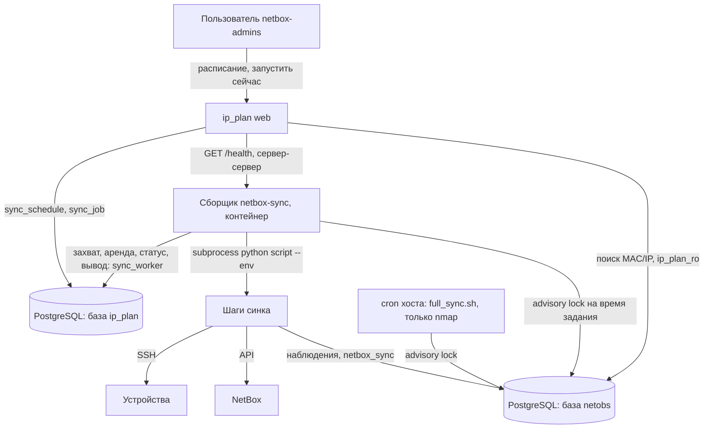
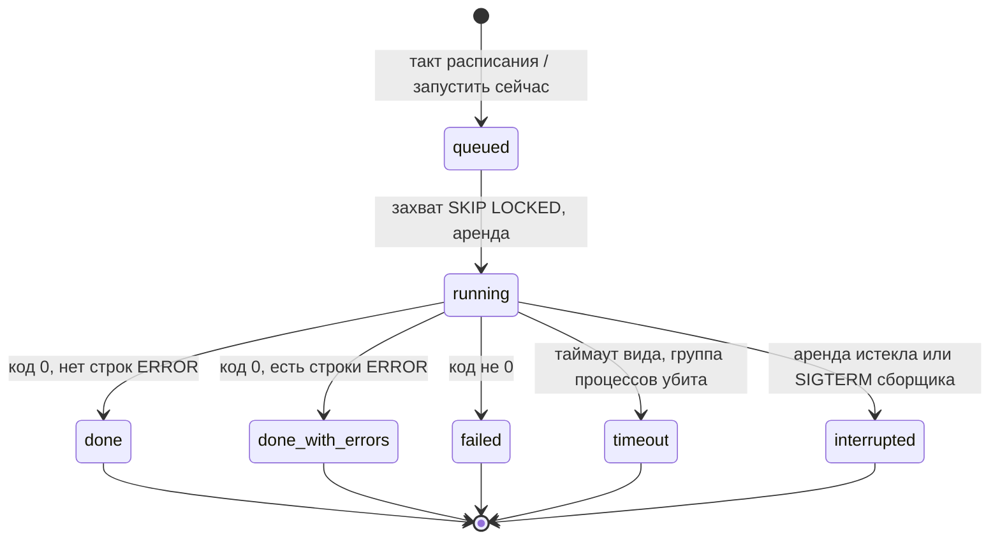
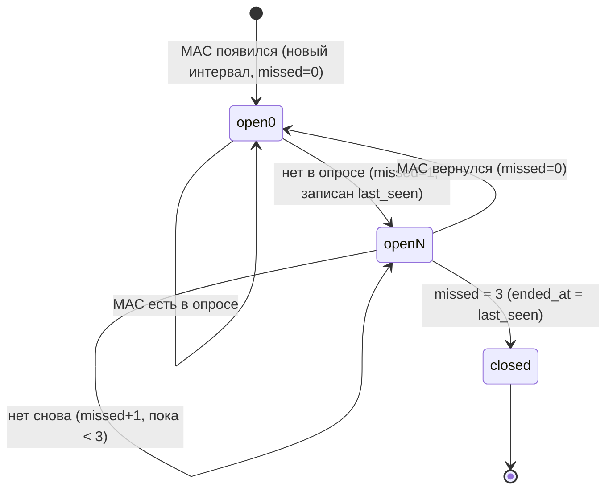
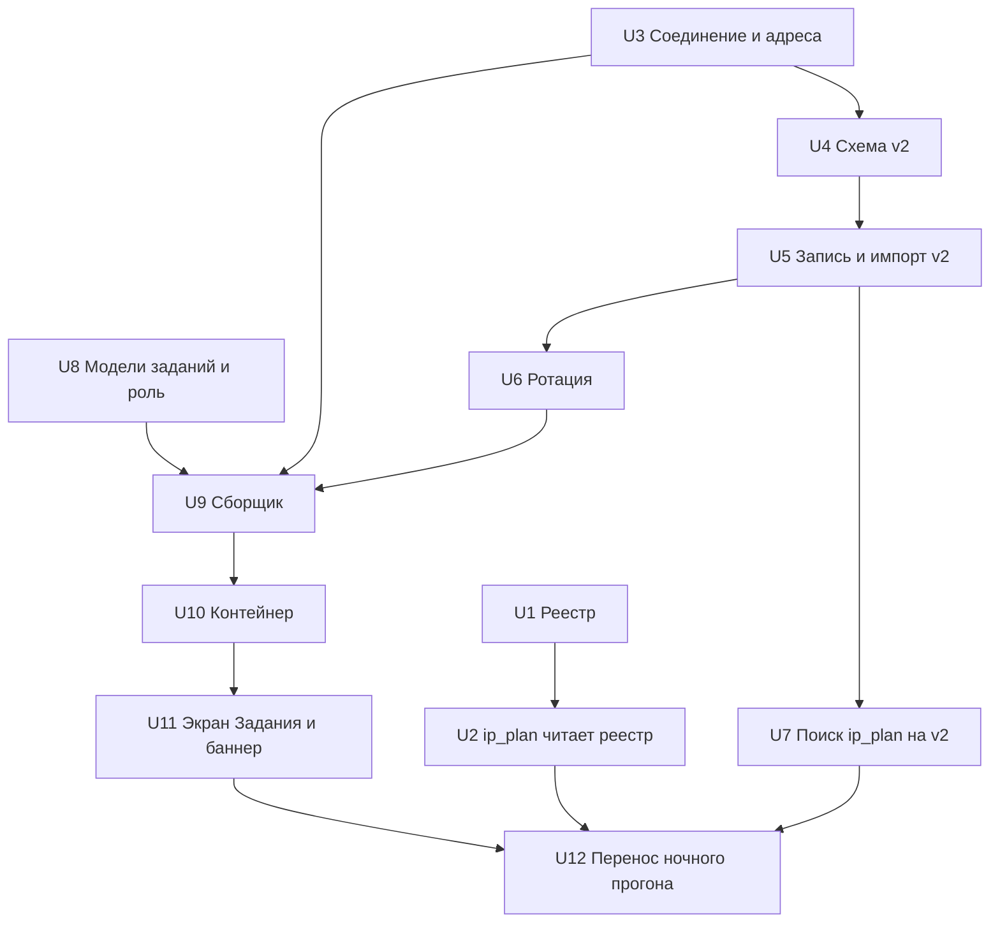

# Этап 2, шаги 1–3 — реестр платформ, netobs v2, сборщик с заданиями - Plan

**Репозитории:** `ip_plan_docker_react` (ветка `feat/observations-stage2`) и `netbox-sync` (ветка `feat/observations-stage2` от `feat/observations-store-stage1`). Пути в юнитах с префиксом `netbox-sync/` относятся ко второму репозиторию, остальные — к `ip_plan_docker_react`.

---

## Goal Capsule

- **Objective:** все операции синка, кроме nmap, запускаются и настраиваются из ip_plan — по расписанию и вручную, с историей и состоянием на экране, — а кабели в NetBox и результаты поиска MAC/IP остаются прежними.
- **Means:** сборщик netbox-sync в контейнере compose ip_plan берёт задания из базы ip_plan (KTD1, KTD3); наблюдения netobs хранятся интервалами (KTD6); возможности платформ описаны одним реестром (KTD9).
- **Authority:** Requirements (R) решают поведение; KTD — механизм в пределах R; юнит не отменяет ни то, ни другое. Дизайн `docs/plans/2026-10-04-observations-stage2-snmp-design.md` — источник решений; при расхождении побеждает этот план, расхождение отмечается.
- **Stop conditions:** остановиться и спросить пользователя, если сверка кабелей с прежними расходится без объяснения (R2), если требуется доступ к проду, push в `main` netbox-sync или отправка кода внешним провайдерам (R16).
- **Execution profile:** локально, два репозитория; коммиты локально в ветки, без пуша; тесты — локально.
- **Finishes:** исполнитель (`ce-work`) реализует и проверяет локально; выкатка на прод — отдельное решение пользователя.

---

## Product Contract

### Summary

Ночной прогон синка (все шаги, кроме nmap) переезжает из `full_sync.sh` в задания, которые ip_plan планирует и запускает, а выполняет постоянный сборщик netbox-sync в контейнере. netobs переходит на схему v2: наблюдения — интервалы, запись только при изменениях, два представления «текущего». Возможности платформ собираются в один реестр, который читают и синк, и ip_plan.

### Problem Frame

Сейчас ночной прогон запускает cron на хосте, ip_plan только читает его лог, а кнопки «запустить» в разделе «Синк» — заглушка. Опрос раз в 1–10 минут (этап 2, SNMP) невозможен ни по нагрузке на базу (строка на каждый MAC на каждом опросе), ни по управлению (cron, PID-файл, нет «запустить сейчас»). Знание о платформах разбросано по шести местам двух репозиториев, и любая новая платформа требует правок в каждом. Подробности — `NETBOX/stage2-snmp-brainstorm-2026-10-04.md` (вне git) и дизайн (see origin).

### Requirements

**Неизменность результата**
- R1. Кабели, которые строит топология, совпадают с прежними 1:1 на тех же данных — сверка со слепком `research/observations-store/baseline-2026-10-03/` (вне git) и с прогоном этапа 1.
- R2. Поиск MAC/IP в ip_plan после миграции netobs возвращает те же строки, «текущее» и «последний раз видели», что до неё.
- R3. Ни одно устройство не начинает опрашиваться иначе из-за реестра платформ: тот же набор шагов, команд и парсеров на каждую модель.

**Реестр платформ**
- R4. Возможности каждой платформы (интерфейсы, MAC, ARP, LLDP, детали LLDP/LACP, VLAN, маркер конфигурации, транспорт) описаны в одном файле данных netbox-sync; ip_plan строит свои списки из него.
- R5. Отсутствующий или нечитаемый реестр — громкая ошибка в ip_plan и в тесте, без тихого возврата к старым спискам.

**Хранилище netobs v2**
- R6. Наблюдение хранится интервалом «появился — пропал»; при стабильной сети опрос не пишет строк наблюдений.
- R7. Доступны два представления текущего: «как раньше» (последний снимок порта) и «окно» (видимо хотя бы в одном из 3 последних успешных опросов; пара устройство+источник «устарела» после 30 минут без успешного опроса).
- R8. Опрос, начатый раньше уже применённого, и импорт с ранним временем не перезаписывают более новое состояние.
- R9. История опросов хранится 7 дней, закрытые интервалы — 90 дней; последний успешный опрос каждой пары и опросы, на которые ссылаются открытые интервалы, не удаляются.
- R10. Ни одна сессия синка не ждёт базу бесконечно: ожидание блокировки, длительность запроса и простой в транзакции ограничены.

**Сборщик и задания**
- R11. Все шаги ночного прогона, кроме nmap, запускаются заданиями — по расписанию и кнопкой «запустить сейчас» (любой шаг белого списка по отдельности). Ночь по умолчанию: цепочка «до nmap» в 02:30 (кастомные поля → VLAN и префиксы), nmap в 03:00 по cron, цепочка «после nmap» по его завершению (синк устройств → бэкап конфигов → блокировки xFW → RedVirt → vCenter → топология → доступность → DNS → ротация), запасное время 06:00, если nmap не завершился.
- R12. Задание не остаётся «выполняется» после падения сборщика: оно переходит в «прервано»; зависший шаг прерывается по таймауту вместе со всеми дочерними процессами.
- R13. Задания, которые пишут в NetBox, и nmap выполняются по одному; задания группы «только netobs» (этап 2, SNMP) идут параллельно с ними.
- R14. ip_plan показывает состояние сборщика баннером на всех страницах и историю заданий с выводом; запускать и править расписание могут только `netbox-admins`.
- R15. Пока выполняется задание или nmap, правки, которые пишут в `conf` netbox-sync, заблокированы.
- R16. Всё выполняется и проверяется локально; прод не трогается, `main` netbox-sync не пушится.

### Key Decisions

- **Кабели и поиск в шагах 1–3 не меняются.** (session-settled: user-directed — chosen over перехода топологии на новое правило свежести сразу: сначала инфраструктура, переключение — через теневую сверку.) Governs R1, R2, R3.
- **Шаги ночного прогона переезжают в задания уже в этом плане; в `full_sync.sh` остаётся nmap.** (session-settled: user-directed — chosen over переноса отдельным этапом позже: проще взаимоисключение и сразу целевое состояние.) Governs R11, R13.
- **Расписание: nmap раз в сутки в 03:00 (днём — вручную на хосте); SNMP раз в 10 минут (этап 2); бэкап конфигов и гипервизоры — раз в сутки и по кнопке; цепочки «до nmap» и «после nmap».** (session-settled: user-approved — chosen over одной цепочки с гонкой за блокировку и цепочки целиком до или после nmap: VLAN и префиксы нужны nmap, его новые IP нужны DNS и топологии в ту же ночь.) Governs R11.
- **Всё локально, прод — отдельным решением.** (session-settled: user-directed — chosen over выкатки этапа 1 до начала этапа 2.) Governs R16.
- **Оповещение — только баннер в ip_plan.** (session-settled: user-directed — chosen over Zabbix: внешнее оповещение вне этапа.) Governs R14.

### Scope Boundaries

- Не входит: SNMP-сбор, VLAN в наблюдениях (колонка есть, пустая), переход топологии на «окно», признак «ответ распознан», диагностика «почему нет кабеля», предполагаемые аплинки, предложения и замены кабелей (таблицы под них — тоже шаг 6), выкатка на прод.

### Deferred to Follow-Up Work

- Шаги 4–7 дизайна: «ответ распознан» и полный снимок MAC-таблицы; SNMP по платформам с теневой сверкой; диагностика, аплинки, замены кабелей; перевод топологии на «окно».
- Исправление ключа `iface_command` в `netbox-sync/netbox_devices_sync.py` `sync_xfw_interfaces` (меняет поведение — реестр фиксирует его как есть).
- `topology.json` пишется без tmp+rename; при частых прогонах — отдельная правка.

---

## Planning Contract

### Key Technical Decisions

- KTD1. **Сборщик — отдельный контейнер в compose ip_plan, под профилем `worker`, только при `IP_PLAN_DB_ENGINE=postgres`.** (session-settled: user-directed — chosen over службы systemd на хосте: всё приложение в одном compose.) Свой entrypoint: никаких `migrate`/`collectstatic` Django.
- KTD2. **Код netbox-sync монтируется только на чтение; образ собирается из `netbox-sync/requirements.txt`.** (session-settled: user-approved — chosen over своего образа из CI netbox-sync и сборки кода в образ ip_plan: cron и сборщик на одной версии кода.) Dockerfile лежит в netbox-sync, контекст сборки — `${NETBOX_SYNC_DIR:-../netbox-sync}`. Каталоги вывода (`config_backups`, `lldp_snapshots`, `firewall_blocklists`, `sync_logs`, каталог отчётов) — на запись, `conf` — на чтение. Web по-прежнему не монтирует корень netbox-sync. Расхождение установленных пакетов с `requirements.txt` — предупреждение в `/health`, задания не блокируются.
- KTD3. **Расписания и задания — модели Django в базе ip_plan с явными `db_table` (`sync_schedule`, `sync_job`); сборщик ходит туда ролью `sync_worker` с правами только на эти таблицы.** (session-settled: user-approved — chosen over таблиц в netobs: расписание — настройка приложения.) Таблицы — стабильный контракт между репозиториями; тест ip_plan закрепляет имена и колонки. Права выдаёт миграция Django (`RunSQL` при PostgreSQL и наличии роли), роль и `CONNECT` — `db/bootstrap.sh`.
- KTD4. **Захват задания — короткая транзакция с арендой.** `UPDATE … WHERE id = (SELECT … FOR UPDATE SKIP LOCKED) RETURNING`, затем commit; дальше heartbeat продлевает `lease_until`. Любой живой сборщик переводит задания с истёкшей арендой в `interrupted`. Состояния: `queued → running → done | done_with_errors | failed | timeout | interrupted`.
- KTD5. **Шаги запускаются отдельными процессами (`python <script> --env <env>`), никогда `full_sync.sh` и никогда nmap.** Скрипты при импорте читают конфиги и argv, копят глобальное состояние и меняют настройки paramiko на весь процесс — импорт в долгоживущий процесс изменил бы поведение. Процесс — в своей группе; таймаут на вид шага; по таймауту SIGTERM группе, пауза, SIGKILL. Вывод — UTF-8 с заменой, без NUL, в строку задания голова и хвост до ~256 КБ, полностью — в файл `sync_logs/worker/<job>.log`. Сборщик сверяет каждый шаг задания со своим белым списком по имени; путь к скрипту и `--env` берёт только из своей конфигурации, не из строки задания; шаг вне списка — задание `failed`, ничего не запускается. Статус `done_with_errors` — по строкам `ERROR` в выводе (у `netbox_devices_sync.py` код выхода всегда 0).
- KTD6. **Наблюдения — интервалы, запись только при изменениях.** (session-settled: user-approved — chosen over обновления строки на каждом опросе: опрос раз в минуту не нагружает базу.) У интервала: `first_seen`, `ended_at`, `missed`, `last_seen` (пишется при первом пропуске), `last_run_id`. Переходы — High-Level Technical Design. Покрытие опроса — порты из вывода (как сейчас); `complete`-источник покрывает устройство целиком, кроме ответа с 0 строк.
- KTD7. **Два представления из одной таблицы; топология и поиск в шагах 1–3 читают «как раньше».** (session-settled: user-approved — chosen over перевода топологии на «окно» сразу: иначе MAC из прошлых опросов поменяли бы кабели.) `current_observations` = открытые интервалы с `missed = 0`, те же колонки, что v1. `current_observations_window` = открытые с `missed < 3` плюс признак «устарело» по паре (устройство, источник). Поиск ip_plan читает представление совместимости `observations_compat`: колонки v1, одна строка на ключ (последний интервал; `first_seen` — самое раннее появление по всем интервалам ключа). `last_seen` открытого интервала в `current_observations` и `observations_compat` — `started_at` последнего применённого успешного опроса пары, в `ports` которого есть порт интервала (у `complete`-опроса с `rows > 0` — любой порт); если такой опрос удалён ротацией — время опроса `last_run_id`. Это правило v1.
- KTD8. **Свежесть — 3 успешных опроса, «устарело» через 30 минут, без стирания.** (session-settled: user-approved — chosen over строгих 30 минут: недоступность устройства не должна стирать данные.) В шагах 1–3 правило действует только внутри представления `current_observations_window`; топология и поиск его не читают (KTD7).
- KTD9. **Реестр платформ — файл данных (`netbox-sync/registry/platforms.json`), описывающий существующие диспетчеры; код синка в шагах 1–3 его не исполняет.** (session-settled: user-approved — chosen over параллельного создания с SNMP: первая задача этапа.) Контрактный тест сверяет реестр с `PARSERS`, `ARP_PARSERS`, ветками деталей LLDP/LACP, `_mac_dispatch`, if/elif интерфейсов, `SNMP_ONLY_PARSERS`, `_VLAN_PARSERS`, `_CONFIG_END_MARKERS` и для каждой модели `devices.json`/`devices.example.json` — набор шагов. Файл лежит в отдельном каталоге `netbox-sync/registry/`; ip_plan монтирует этот каталог только на чтение (монтирование одного файла держит старый inode после `git checkout`/`rsync`, а отсутствующий файл Docker превращает в каталог). Поле `registry_version`.
- KTD10. **Состояние применения по паре (устройство, источник).** Таблица `apply_state(nb_device, source, last_applied_started_at, last_applied_run_id)`. Опрос старше применённого пишется в `poll_runs` с `applied = false` и интервалы не трогает. Импорт на паре, где уже были настоящие опросы, создаёт только закрытые исторические интервалы; на паре без опросов — открытые с пустым `first_seen`.
- KTD11. **Один открытый интервал на ключ** — частичный уникальный индекс `… WHERE ended_at IS NULL`, `NULLS NOT DISTINCT`. VLAN входит в ключ и в шагах 1–3 всегда пуст; правило заполнения VLAN у открытых интервалов определяет план шага 5.
- KTD12. **Ограничения ожидания базы — на соединение.** `lock_timeout` 10 с, `statement_timeout` 60 с, `idle_in_transaction_session_timeout` 60 с через `options` в `netobs.connect`; миграции ставят свои значения `SET LOCAL` первой строкой. Неблокирующий вариант блокировки пары (`try_lock`) добавляется в API для будущего SNMP-опроса; блокирующий `lock` остаётся для записи.
- KTD13. **Взаимоисключение — сессионная advisory-блокировка PostgreSQL в базе netobs.** (session-settled: user-approved — chosen over PID-файла: PID контейнера на хосте не существует.) Её держат сборщик на время задания группы «пишет в NetBox» и сам `scan_all.py` (функция в `netbox-sync/netobs.py`), так что и запуск через `full_sync.sh`, и прямой ручной запуск сканера днём под неё попадают. Захват — циклом `pg_try_advisory_lock` с паузой в несколько секунд, без верхнего предела, со статусом «ждёт блокировку» (у сборщика — в задании); блокирующий `pg_advisory_lock` под таймаутами KTD12 не используется. Ключ — отдельная константа, не равная ключу миграций. Соединение блокировки — отдельное, в autocommit, без таймаутов KTD12. Перед каждым шагом сборщик проверяет, что соединение блокировки живо; потеря — повторный захват до запуска следующего шага, текущий шаг доходит до конца. Без `conf/netobs.json` сканер блокировку не берёт (прод до этапа 1). PID-файл `sync_logs/.full_sync.lock` остаётся для nmap ради ip_plan.
- KTD14. **Группы блокировки: «пишет в NetBox» — одно задание за раз и общая блокировка KTD13 с nmap; «только netobs» — параллельно, блокировка на (устройство, источник).** (session-settled: user-approved — chosen over одного правила «одно задание за раз» для всех: частый SNMP-опрос не должен ждать двухчасовой nmap или ночную цепочку.) Группа — свойство шага в белом списке сборщика; в шагах 1–3 все шаги в группе «пишет в NetBox», поведение прежнее. Повторный «запустить сейчас» того же вида возвращает существующее задание — частичный уникальный индекс по виду для `queued`/`running`.
- KTD15. **Расписание — цепочка шагов или один шаг; запуск — по интервалу, по времени суток или по событию «nmap завершился» с запасным временем; пропущенные такты не догоняются.** Событие: общая блокировка KTD13 свободна и в логе nmap есть строка завершения с датой этой ночи; не наступило к запасному времени — цепочка стартует и баннер пишет «ночной nmap не прошёл». После простоя создаётся одно задание (`next_run = now + interval` либо следующее суточное время). Суточные расписания — в часовом поясе `SYNC_LOG_TZ`. Задание работает со снимком параметров расписания. Расписания по умолчанию — по R11; время nmap — из `SYNC_SCHEDULE`.
- KTD16. **Адреса для контейнера — переопределения окружением.** `NETOBS_HOST`/`NETOBS_PORT` в `netobs.load_config`, `NETBOX_SYNC_NETBOX_URL` в общем загрузчике конфигурации (`netbox-sync/conf_loader.py`), которым начинают пользоваться скрипты. Без переменных поведение прежнее. Каталог отчётов vCenter/RedVirt — переменная `NETBOX_SYNC_REPORTS_DIR`, по умолчанию корень, как сейчас.
- KTD17. **`/health` — HTTP внутри compose и тот же JSON файлом; отдаёт кэш состояния цикла, базу не опрашивает.** ip_plan ходит к нему со стороны сервера, таймаут 1–2 с, кэш 15–30 с. Без профиля `worker` или на SQLite баннера нет. Результат задания при недоступной базе сохраняется в `sync_logs/worker/<job>.result.json` и дописывается при восстановлении.
- KTD18. **Блокировка правок — всё, что пишет в `netbox-sync/conf`, кроме LDAP и настроек самого ip_plan; источник состояния — задание `running` с живой арендой или занятая блокировка KTD13 (`pg_locks` в netobs, роль `ip_plan_ro`).** (session-settled: user-approved — chosen over блокировки только импорта.) Ответ 409 с текстом. PID-файл nmap используется только сводкой «Синк» (после SIGKILL он остаётся и не должен блокировать правки). В задании сохраняется хеш `conf` на старте.
- KTD19. **Сводка «Синк» строится по заданиям, для nmap — по логу `full_sync.sh`.** (session-settled: user-approved — chosen over одного разбора лога: шаги переехали в задания.) Ручная копия `STEPS` в `ip_plan/services/sync_log.py` заменяется списком шагов из реестра заданий.
- KTD20. **Миграции netobs применяет сборщик при старте под блокировкой KTD13; отката схемы нет.** Бэкап перед миграцией — ручной шаг оператора на хосте (`scripts/pg_backup.sh`) до переключения кода netbox-sync на версию с новой миграцией; сборщик бэкап не делает. Строгое равенство `SCHEMA_VERSION` сохраняется: код и схема переключаются вместе.

### High-Level Technical Design

Компоненты и потоки:

Жизненный цикл задания (KTD4, KTD5, KTD14, KTD17):

Интервал наблюдения при применённом успешном опросе, покрывающем порт (KTD6, KTD10):

Неудачный опрос, опрос с `applied = false` и `complete`-ответ с 0 строк переходов не вызывают. «Как раньше» видит только `open0`, «окно» — `open0` и `openN`. MAC, вернувшийся после закрытия, открывает новый интервал.

### Assumptions

- Локально Docker Desktop выпускает контейнер к устройствам через VPN хоста; если нет — шаги с SSH проверяются из контейнера на доступных устройствах, а недоступность фиксируется в отчёте (как HW5000 и Континент в этапе 1).
- `host.docker.internal` доступен из контейнера на Docker Desktop для локального NetBox (`localhost:8000` на хосте).

### Sequencing

---

## Implementation Units

| U-ID | Что | Основные файлы | Зависит от |
|---|---|---|---|
| U1 | Реестр платформ и контрактный тест | `netbox-sync/registry/platforms.json`, `netbox-sync/tests/test_platforms.py` | — |
| U2 | ip_plan читает реестр | `ip_plan/services/sync_config.py`, `docker-compose.yml` | U1 |
| U3 | Соединение netobs: таймауты, try_lock, адреса | `netbox-sync/netobs.py`, `netbox-sync/conf_loader.py` | — |
| U4 | Схема netobs v2 и перенос данных | `netbox-sync/netobs/migrations/0002_intervals.sql` | U3 |
| U5 | Запись опросов и импорт на v2 | `netbox-sync/netobs.py`, `netbox-sync/netobs_import_netbox.py` | U4 |
| U6 | Ротация | `netbox-sync/netobs.py`, `netbox-sync/netobs_retention.py` | U5 |
| U7 | Поиск ip_plan на v2 | `ip_plan/services/netobs_search.py` | U5 |
| U8 | Модели расписаний и заданий, роль `sync_worker` | `ip_plan/models.py`, `db/bootstrap.sh` | — |
| U9 | Сборщик | `netbox-sync/worker.py`, `netbox-sync/worker_steps.py` | U3, U6, U8 |
| U10 | Контейнер сборщика | `netbox-sync/docker/worker.Dockerfile`, `docker-compose.yml` | U9 |
| U11 | Экран «Задания», баннер, блокировка правок | `ip_plan/views_jobs.py`, `ip_plan/templates/ip_plan/base.html` | U8, U10 |
| U12 | Перенос ночного прогона, сверка, документация | `netbox-sync/full_sync.sh`, `netbox-sync/scan_all.py`, `ip_plan/services/sync_log.py` | U2, U7, U11 |

### U1. Реестр платформ и контрактный тест

**Goal:** один файл данных описывает возможности каждой из 7 платформ так, как их сейчас реализует код.

**Requirements:** R3, R4, R5; KTD9.

**Dependencies:** —

**Files:**
- `netbox-sync/registry/platforms.json` (новый)
- `netbox-sync/tests/test_platforms.py` (новый)
- `netbox-sync/CLAUDE.md`

**Approach:**
1. По платформе: транспорт, интерфейсы, MAC-таблица (с оговоркой «xfw — только в кластере»), ARP (интерфейсный у continent, `arp_command` только у eltex_status), LLDP, детали LLDP/LACP, VLAN-парсер (с явным «fallback на ROS»), маркер конца конфигурации, особенности имён портов.
2. Дефолты команд (`no_pager`, `*_command`) — справочные поля; код их не читает.
3. `registry_version` на верхнем уровне; известный баг `iface_command` у xfw отмечен полем-примечанием.

**Patterns to follow:** исследование диспетчеров — Sources; форма JSON и ошибки загрузки проверяются в самом тесте (отдельного модуля-загрузчика нет, пока код синка реестр не исполняет).

**Test scenarios:**
- Каждый ключ `PARSERS` топологии ↔ платформы с `lldp`; лишних и недостающих нет.
- `ARP_PARSERS` ↔ платформы с ARP L3; ветки деталей LLDP/LACP ↔ поля деталей.
- `_mac_dispatch` и путь continent ↔ поле MAC/ARP; xfw с MAC только при `cluster`.
- `SNMP_ONLY_PARSERS` ↔ транспорт `snmp`; `_VLAN_PARSERS` ↔ поле VLAN, включая fallback.
- `_CONFIG_END_MARKERS` ↔ маркеры конфигурации.
- Для каждой модели `conf/devices.example.json` (и `conf/devices.json`, если есть) — платформа найдена, набор шагов совпадает с выводом диспетчеров (характеризационный тест).
- Битый JSON или пропущенное обязательное поле → понятная ошибка загрузки.

**Verification:** тест проходит на текущем коде без изменений диспетчеров; полный набор тестов netbox-sync зелёный.

### U2. ip_plan читает реестр

**Goal:** списки парсеров и возможностей в ip_plan строятся из реестра.

**Requirements:** R3, R4, R5; KTD9.

**Dependencies:** U1

**Files:**
- `ip_plan/services/sync_config.py`
- `config/settings.py` (путь `NETBOX_SYNC_PLATFORMS_FILE`)
- `docker-compose.yml` (монтирование каталога `registry/` только на чтение)
- `ip_plan/views_settings.py`, `ip_plan/templates/ip_plan/_settings_models.html`, `ip_plan/templates/ip_plan/settings_model.html` (только если меняется источник данных)
- `ip_plan/tests/test_platform_registry.py` (новый), `ip_plan/tests/fixtures/platforms.json` (новый)

**Approach:**
1. `INTERFACE_PARSERS`, `SNMP_PARSERS`, `MAC_CAPABLE_PARSERS`, `LLDP_CAPABLE_PARSERS`, `parser_catalog()` вычисляются из реестра; внешний интерфейс модуля не меняется.
2. Нет файла → `SyncConfigError` с текстом; страница настроек показывает плашку по образцу `available()`.
3. Монтирование каталога `registry/`, как прочие каталоги netbox-sync; корень кода в web не монтируется.

**Patterns to follow:** `sync_config.load`/`available`; идиома `config(X, default="") or str(BASE_DIR/...)` в `config/settings.py`; проверка соседнего репозитория со `skipTest` в `ip_plan/tests/test_settings.py`.

**Test scenarios:**
- Фикстура реестра → множества совпадают с прежними константами поэлементно.
- Реальный `../netbox-sync/registry/platforms.json` (если рядом) → те же множества, что фикстура.
- Нет файла → `validate_device` и страница модели отдают понятную ошибку, не 500.
- Сохранение устройства с `sync_macs` на xfw без кластера — та же проверка, что сейчас.

**Verification:** тесты ip_plan зелёные на SQLite и PostgreSQL; страницы «Модели» и «Устройство» показывают те же парсеры и флаги.

### U3. Соединение netobs: таймауты, try_lock, адреса для контейнера

**Goal:** сессии синка не ждут базу бесконечно, а контейнер находит netobs и NetBox по своим адресам.

**Requirements:** R10; KTD12, KTD16.

**Dependencies:** —

**Files:**
- `netbox-sync/netobs.py`
- `netbox-sync/conf_loader.py`
- скрипты шагов, читающие `conf/config.json` (переход на общий загрузчик): `netbox-sync/netbox_devices_sync.py`, `netbox-sync/netbox_lldp_topology.py` и прочие из `STEP_SCRIPTS`
- `netbox-sync/tests/test_netobs.py`, `netbox-sync/tests/test_conf_loader.py` (новый)

**Approach:**
1. `connect` передаёт таймауты через `options`; значения переопределяются в `conf/netobs.json`.
2. `try_lock(conn, dev, source)` — `pg_try_advisory_xact_lock`, возвращает признак; `lock` не меняется.
3. `load_config` накладывает `NETOBS_HOST`/`NETOBS_PORT`; общий загрузчик накладывает `NETBOX_SYNC_NETBOX_URL`; без переменных — прежние значения.

**Patterns to follow:** `netobs.load_config` (верхний уровень + `environments.<env>`); `conf_loader.conf_path`.

**Test scenarios:**
- Без переменных окружения адреса и URL прежние (для каждого скрипта — тот же конфиг).
- С переменными — подставлены только они.
- Живая база: сессия с `lock_timeout` при чужой блокировке получает ошибку за ~10 с, а не ждёт.
- `try_lock` при занятой паре возвращает «занято» сразу; при свободной — берёт.
- Сессия, оставившая транзакцию открытой дольше 60 с, закрыта сервером.
- Существующий тест «запись одной пары ждёт» (`test_concurrent_record_same_device_source_waits`) проходит без изменений.

**Verification:** тесты netbox-sync зелёные; ночной путь записи ведёт себя как раньше.

### U4. Схема netobs v2 и перенос данных этапа 1

**Goal:** миграция `0002` переводит наблюдения в интервалы и добавляет оба представления текущего и представление совместимости.

**Requirements:** R6, R7, R9; KTD6, KTD7, KTD10, KTD11, KTD20.

**Dependencies:** U3

**Files:**
- `netbox-sync/netobs/migrations/0002_intervals.sql` (новый)
- `netbox-sync/netobs.py` (`SCHEMA_VERSION = 2`)
- `netbox-sync/tests/test_netobs_v2_migration.py` (новый)

**Approach:**
1. Первая строка — `SET LOCAL` увеличенных таймаутов.
2. `observations`: `ended_at`, `missed`; `seen_count` удаляется; уникальность — частичный индекс по открытым (KTD11); FK `last_run_id` — `ON DELETE SET NULL`.
3. `poll_runs`: `applied`, `ports text[]`; `poll_ports` переносится в массив и удаляется; новая таблица `apply_state`.
4. Перенос: строки v1 `current_observations` → открытые с `missed = 0`; прочие → закрытые с `ended_at = last_seen`; `apply_state` — по последнему успешному опросу пары.
5. Представления `current_observations` (колонки v1), `current_observations_window`, `observations_compat` (KTD7); гранты `ip_plan_ro`.

**Execution note:** сначала тест эквивалентности: снимок v1 `current_observations` на данных этапа 1 до миграции равен v2 `current_observations` после.

**Patterns to follow:** `netbox-sync/netobs/migrations/0001_init.sql`; фикстуры `db`/`_wipe` в `netbox-sync/tests/test_netobs.py`.

**Test scenarios:**
- Данные с обычными, `complete`-опросами и импортом → v2 «как раньше» == v1 текущее (строка в строку).
- `observations_compat` для 20 выбранных MAC/IP == v1 `observations` + `run_kind` по видимым полям поиска.
- Порт есть в первом опросе и отсутствует во втором → «последний раз» = время первого опроса, как в v1.
- MAC закрыт и открыт снова → в `observations_compat` одна строка, `first_seen` — первое появление.
- Повторный `migrate` → «актуальна», без изменений.
- Ошибка посреди миграции (подставной сбой) → версия 1, данные на месте.
- `ip_plan_ro` читает три представления и не может писать.
- После миграции «окно» сразу после переноса не содержит строк, которые v1 уже не считал текущими (задокументированная норма).

**Verification:** тесты на живой `netobs_test` зелёные; локальная netobs мигрирована после `scripts/pg_backup.sh`, `netobs_migrate.py` сообщает версию 2.

### U5. Запись опросов и импорт на v2

**Goal:** `record_output`/`record_failure`/`record_poll` пишут интервалы по KTD6 и KTD10; импорт работает по KTD10; результат для топологии прежний.

**Requirements:** R1, R6, R8; KTD6, KTD10.

**Dependencies:** U4

**Files:**
- `netbox-sync/netobs.py`
- `netbox-sync/netobs_import_netbox.py`
- `netbox-sync/tests/test_netobs.py`, `netbox-sync/tests/test_netobs_observed.py`, `netbox-sync/tests/test_netobs_import.py`, `netbox-sync/tests/test_topology_netobs.py`

**Approach:**
1. Под той же блокировкой пары: сравнить вывод с открытыми интервалами покрытых портов, применить переходы, обновить `apply_state`; опрос старше применённого — `applied = false`.
2. Сигнатуры публичных функций и формы возвращаемых значений не меняются; `observed_from_rows` читает «как раньше».
3. Импорт: пара с настоящими опросами → закрытые интервалы; без опросов → открытые с пустым `first_seen`.

**Execution note:** держать зелёными существующие тесты R9 этапа 1 (`test_netobs_observed.py`) — это и есть проверка R1 на уровне данных.

**Patterns to follow:** `_prepare`, `lock`, `record_output` в `netbox-sync/netobs.py`.

**Test scenarios:**
- Первый опрос → интервалы открыты, `missed = 0`.
- Повторный опрос с тем же выводом → ни одной записи в `observations` (проверка числа изменённых строк).
- MAC пропал: 1 опрос → `missed = 1`, `last_seen` записан; 3 опроса → закрыт, `ended_at = last_seen`; вернулся после 1 пропуска → `missed = 0`; вернулся после закрытия → новый интервал.
- Порт отсутствует в выводе (не покрыт) → его интервалы не меняются.
- MAC переехал с A на B за опрос → «как раньше» показывает только B, «окно» — A (`missed = 1`) и B.
- Неудачный опрос и `complete` с 0 строк → переходов нет; `complete` с N строк закрывает пропавшие порты устройства через окно.
- Опрос B (t2) применён, затем A (t1 < t2) → интервалы прежние, A с `applied = false`.
- Импорт после настоящего опроса → открытые интервалы не меняются; импорт на пустой паре → открытые, `first_seen` пуст.
- Последовательность опросов этапа 1 через старую и новую реализацию → одинаковое `observed_from_rows`.
- Два писателя одной пары → второй ждёт (блокирующий `lock`), данные согласованы.

**Verification:** топология по сохранённым снимкам на v2 даёт те же кабели, что на v1 (R1).

### U6. Ротация

**Goal:** история опросов и закрытые интервалы удаляются по срокам R9 без потери нужного.

**Requirements:** R9; KTD12.

**Dependencies:** U5

**Files:**
- `netbox-sync/netobs.py` (функция ротации)
- `netbox-sync/netobs_retention.py` (новый: шаг-скрипт)
- `netbox-sync/tests/test_netobs_retention.py` (новый)

**Approach:**
1. Удаление пачками с таймаутом; одна ротация одновременно (`try_lock` на служебный ключ).
2. Не удаляются: последний успешный опрос пары, опросы из `apply_state`, опросы, на которые ссылаются открытые интервалы.
3. Сроки — в `conf/netobs.json` (`retention_days`, по умолчанию 7 и 90).

**Patterns to follow:** структура шага-скрипта `netbox-sync/netobs_migrate.py` (`--env`, коды выхода, `out()`).

**Test scenarios:**
- Опросы старше 7 дней удалены, кроме последнего успешного каждой пары.
- Устройство молчит 10 дней → его последний успешный опрос на месте, «устарело» считается.
- Закрытые интервалы старше 90 дней удалены; открытые не тронуты.
- Вторая ротация при идущей первой → выходит «уже идёт», код 0.

**Verification:** после ротации «как раньше» и «окно» не меняются.

### U7. Поиск ip_plan на v2

**Goal:** страница «Поиск MAC/IP» работает на `observations_compat` и даёт прежние результаты.

**Requirements:** R2; KTD7.

**Dependencies:** U5

**Files:**
- `ip_plan/services/netobs_search.py`
- `ip_plan/tests/test_obs_search.py`

**Approach:** запрос читает `observations_compat` вместо `observations` + `poll_runs`; колонка «сколько раз видели» убирается со страницы (в v2 счётчика нет).

**Patterns to follow:** `SqlStore` и `FakeCursor` в `ip_plan/tests/test_obs_search.py`.

**Test scenarios:**
- Тот же набор строк для MAC, IP, частичного MAC на подставном курсоре v2.
- Открытый интервал без пропусков → «последний раз» = последний успешный опрос пары.
- Недоступная netobs → сообщение, 200, как сейчас.

**Verification:** живая проверка на локальной netobs v2: 20 MAC/IP из списка этапа 1 дают те же «текущее» и «последний раз».

### U8. Модели расписаний и заданий, роль `sync_worker`

**Goal:** в базе ip_plan есть таблицы-контракт `sync_schedule` и `sync_job` и роль сборщика с минимальными правами.

**Requirements:** R11, R12, R13; KTD3, KTD4, KTD14, KTD15.

**Dependencies:** —

**Files:**
- `ip_plan/models.py`, `ip_plan/migrations/0012_sync_jobs.py` (новый)
- `db/bootstrap.sh`, `.env.db.example`, `.gitlab-ci.yml` (проверка пустого пароля и heredoc `.env.db`)
- `ip_plan/services/db_transfer.py` (`EXCLUDED_MODELS`: задания не переносятся в SQLite)
- `ip_plan/tests/test_sync_jobs_models.py` (новый), `ip_plan/tests/test_compose_postgres.py`

**Approach:**
1. `sync_schedule`: вид (шаг или цепочка), список шагов, запуск (интервал / время суток / «после nmap» с запасным временем), включено, `next_run`.
2. `sync_job`: вид, шаги, источник (расписание/пользователь, кто), статус, `worker_id`, `lease_until`, время начала/конца, по шагам — статус и длительность, голова/хвост вывода, путь полного лога, хеш `conf`, `VERSION` кода.
3. Частичный уникальный индекс «один `queued`/`running` на вид» и `UNIQUE(schedule_id, scheduled_for)`.
4. Права `sync_worker`: `SELECT, INSERT, UPDATE` на `sync_job`; `SELECT` и `UPDATE (next_run)` на `sync_schedule`; `USAGE` на последовательности их id; к прочим таблицам ip_plan доступа нет. Роль и `CONNECT` — `bootstrap.sh`; табличные права выдают и миграция `RunSQL` (при PostgreSQL и наличии роли), и `bootstrap.sh` (если таблицы уже есть) — права сходятся при любом порядке запуска.
5. В `sync_job` — поле `wait_reason` (например, «ждёт nmap») для отображения ожидания блокировки KTD13.

**Patterns to follow:** `ConnectionTest` в `ip_plan/models.py`; роли и `\getenv` в `db/bootstrap.sh`; проверки в `ip_plan/tests/test_compose_postgres.py`.

**Test scenarios:**
- Имена таблиц и колонок контракта закреплены тестом.
- Два `queued` одного вида → ошибка уникальности.
- На SQLite миграция проходит без `RunSQL`.
- На PostgreSQL `sync_worker` вставляет и обновляет `sync_job`, сдвигает `next_run` в `sync_schedule`; запись в другие колонки `sync_schedule`, удаление и доступ к прочим таблицам отклоняются.
- Порядок «миграция до роли, затем `bootstrap.sh`» и обратный дают одинаковые права.
- `bootstrap.sh` требует пароль `sync_worker`; CI проверяет его на пустоту.

**Verification:** тесты ip_plan зелёные на обоих движках; `bootstrap.sh` повторно применяется к существующему локальному тому.

### U9. Сборщик

**Goal:** долгоживущий процесс netbox-sync выполняет задания из базы ip_plan по KTD4, KTD5, KTD13–KTD17, KTD20.

**Requirements:** R11, R12, R13, R14; KTD4, KTD5, KTD13, KTD14, KTD15, KTD17, KTD20.

**Dependencies:** U3, U6, U8

**Files:**
- `netbox-sync/worker.py` (новый)
- `netbox-sync/worker_steps.py` (новый: белый список шагов, таймауты по видам)
- `netbox-sync/tests/test_worker.py` (новый)

**Approach:**
1. При старте: миграции netobs под блокировкой; перевод просроченных заданий в `interrupted`; сверка пакетов с `requirements.txt`.
2. Цикл: планировщик (KTD15) → захват (KTD4) → блокировка KTD13 → шаги цепочки по одному (KTD5) → heartbeat → результат; при недоступной базе — файл результата и дозапись.
3. SIGTERM: убить группу текущего шага, записать `interrupted`.
4. `/health` в отдельном потоке и файл состояния; смена `VERSION` кода в простое → выход для перезапуска контейнером.
5. Белый список шагов = `STEP_SCRIPTS` `full_sync.sh` без `scan_all.py` и без миграций, плюс `netobs_retention.py`; у каждого шага — группа блокировки (KTD14) и таймаут.

**Execution note:** механику (захват, аренда, таймауты, `interrupted`) проверять на фиктивных скриптах, а не на настоящих шагах.

**Patterns to follow:** порядок и аргументы шагов в `netbox-sync/full_sync.sh`; модуль без побочных эффектов при импорте — `netbox-sync/netobs.py`.

**Test scenarios:**
- Задание из расписания: `queued → running → done`, вывод и длительность записаны.
- Фиктивный шаг печатает `ERROR` и выходит с 0 → `done_with_errors`; выходит с 2 → `failed`, цепочка продолжается или останавливается по флагу цепочки.
- Шаг порождает потомка `sleep 9999` и превышает таймаут → `timeout`, ни одного процесса не осталось.
- `kill -9` сборщика посреди задания → после истечения аренды другой экземпляр ставит `interrupted`.
- Две копии сборщика → каждое задание захвачено один раз; по такту расписания одно задание.
- Сборщик выключен на 3 периода → после старта одно задание.
- Повторный «запустить сейчас» → возвращается существующее задание.
- Расписание «после nmap»: nmap завершился → цепочка стартует; nmap не завершился к запасному времени → цепочка стартует, состояние «ночной nmap не прошёл».
- Фиктивный шаг группы «только netobs» выполняется, пока занята общая блокировка; два шага группы «пишет в NetBox» — по одному.
- Блокировка KTD13 занята дольше `lock_timeout` и `statement_timeout` (держит `scan_all.py` или тестовая заглушка) → задание ждёт с `wait_reason`, затем выполняется; ошибок таймаута нет.
- Соединение блокировки оборвано между шагами → следующий шаг не стартует до повторного захвата.
- Задание с шагом вне белого списка или с путём к скрипту → `failed` с причиной, процесс не запущен.
- Вывод 50 МБ с NUL и KOI8-R → задание завершено, вывод обрезан с пометкой, полный лог в файле.
- База недоступна на завершении → результат в файле, дописан после восстановления, статус не `interrupted`.
- `/health` при остановленной базе отвечает ≤ 1 с с `db: down`.

**Verification:** тесты сборщика зелёные на живой `netobs_test` и тестовой базе ip_plan.

### U10. Контейнер сборщика

**Goal:** `docker compose --profile worker up` поднимает сборщик, который выполняет каждый шаг белого списка внутри контейнера.

**Requirements:** R11; KTD1, KTD2, KTD16.

**Dependencies:** U9

**Files:**
- `netbox-sync/docker/worker.Dockerfile` (новый), `netbox-sync/docker/worker-entrypoint.sh` (новый)
- `netbox-sync/netbox_vcenter_sync.py`, `netbox-sync/netbox_redvirt_sync.py`, `netbox-sync/netbox_lldp_topology.py` (каталог отчётов — KTD16; топология читает отчёт vCenter оттуда же)
- `docker-compose.yml`, `.env.example`, `ip_plan/tests/test_compose_postgres.py`

**Approach:**
1. Сервис `worker` под профилем `worker`: `init: true`, `stop_grace_period` больше паузы SIGTERM→SIGKILL, `PYTHONDONTWRITEBYTECODE=1`, `env_file` — только нужные переменные (не `.env.db` целиком), переменные KTD16.
2. Монтирования KTD2: код и `conf` — только на чтение; каталоги вывода и отчётов — на запись; SSH-ключи — только на чтение.
3. `/health` не публикуется на хост.

**Execution note:** в основном конфигурация; доказательство — дымовой прогон каждого шага в контейнере, а не модульные тесты.

**Patterns to follow:** профиль `gateway` и сервисы guacd/guacamole в `docker-compose.yml`; разбор сервисов в `ip_plan/tests/test_compose_postgres.py`.

**Test scenarios:**
- Тест compose: у `worker` нет секретов БД ip_plan сверх своей роли; код смонтирован только на чтение; web по-прежнему не монтирует корень netbox-sync.
- Дымовой: `netobs_migrate`, `netbox_ensure_custom_fields`, devices, config backup, firewall blocklist, RedVirt, vCenter, топология, reachability, DNS — каждый завершается в контейнере; отчёты пишутся в каталог отчётов; без переменной KTD16 скрипты на хосте пишут туда же, что раньше.

**Verification:** все шаги белого списка проходят в контейнере; файлы вывода на хосте те же, что после ручного запуска.

### U11. Экран «Задания», баннер, блокировка правок

**Goal:** `netbox-admins` управляют расписаниями и запусками в ip_plan; все видят состояние сборщика; правки `conf` заблокированы во время работы.

**Requirements:** R14, R15; KTD14, KTD17, KTD18.

**Dependencies:** U8, U10

**Files:**
- `ip_plan/views_jobs.py` (новый), `ip_plan/urls.py`, `ip_plan/templates/ip_plan/jobs.html` (новый), `ip_plan/templates/ip_plan/job_detail.html` (новый)
- `ip_plan/services/worker_health.py` (новый)
- `ip_plan/templates/ip_plan/base.html`, `ip_plan/static/ip_plan/js/app.js`, `ip_plan/context_processors.py`
- `ip_plan/views_settings.py` (блокировка правок, замена заглушки `sync_run`), `ip_plan/services/sync_config.py` (`sync_running`)
- `ip_plan/tests/test_jobs.py` (новый), `ip_plan/tests/test_settings.py`

**Approach:**
1. Раздел «Задания»: список расписаний (правка — `staff_required`), «запустить сейчас», история с фильтром по статусу, страница задания с выводом и шагами; автообновление htmx, пока задание идёт.
2. Баннер: JSON-эндпоинт ip_plan проксирует `/health` (KTD17); Alpine store по образцу индикатора синка.
3. Блокировка KTD18 — общая проверка для всех форм, пишущих в `conf`; ответ 409.
4. Кнопки раздела «Синк» создают задания (KTD19 — здесь только кнопки; сводка — U12).
5. Аудит: запуск и правка расписания пишутся в `SettingsAudit` (scope `sync`).
6. Форма расписания: вид (цепочка или один шаг), упорядоченный выбор шагов из белого списка, «интервал» или «время суток (`SYNC_LOG_TZ`)», «включено». Проверки: интервал не меньше 1 минуты, цепочка не пуста, шаги только из белого списка. После сохранения показывается вычисленный `next_run`; ошибки — рядом с полем.
7. Баннер: состояния ниже; норма — без баннера (индикатор в шапке).
8. Пока правки заблокированы: на формах `conf` плашка с причиной (задание или nmap) и ссылкой, кнопка сохранения отключена; при 409 форма остаётся заполненной, текст называет задание; страницы просмотра доступны.
9. Экран задания: пустые состояния («ещё не запускалось», «нет расписаний»), `queued`/`running` с текущим шагом и `wait_reason`, пометка «вывод обрезан, полный лог: <путь>». Повторный «запустить сейчас» — уведомление «задание этого вида уже выполняется» и переход на него. У не-staff кнопки «запустить» и «править» отключены с подсказкой «нужна группа netbox-admins».
10. Доступность: у каждого статуса текстовая подпись, баннер — `role="status"`; автообновление сохраняет прокрутку и останавливается по завершении задания.

| Состояние | Текст баннера | Уровень |
|---|---|---|
| `/health` не отвечает | «Сборщик не отвечает» + ссылка на «Задания» | ошибка |
| `db: down` | «Сборщик не достаёт базу» | ошибка |
| последнее плановое задание `failed` / `timeout` / `interrupted` | «Ночная цепочка: <статус>» + ссылка на задание | предупреждение |
| цепочка «после nmap» стартовала по запасному времени | «Ночной nmap не прошёл» | предупреждение |
| пакеты расходятся с `requirements.txt` | «Сборщику нужна пересборка образа» | предупреждение |
| идёт задание | без баннера, индикатор «выполняется <вид>» | — |

**Patterns to follow:** `staff_required` в `ip_plan/views_settings.py`; индикатор синка `$store.sync` в `base.html` и `app.js`; `_SECTION_TITLES` в `context_processors.py`; `Unavailable` в `netobs_search.py`.

**Test scenarios:**
- Не-staff: страница «Задания» видна, «запустить» и правка расписания → 403.
- Staff: «запустить сейчас» создаёт задание; повторно → то же задание.
- Сборщик не отвечает → баннер «сборщик не отвечает», страницы открываются ≤ 2 с.
- Профиль `worker` выключен или SQLite → баннера и раздела нет.
- Задание `running` с живой арендой → сохранение устройства/модели/гипервизора/SSH-ключа → 409; LDAP сохраняется.
- Аренда истекла → правка снова доступна.
- Пользователь со сменой пароля по требованию не получает редирект на JSON баннера.
- Идёт nmap (блокировка KTD13 занята) → формы `conf` с плашкой и отключённой кнопкой; после снятия блокировки — доступны.
- PID-файл nmap остался после сбоя, блокировка свободна → правки доступны.

**Verification:** ручная проверка в браузере локально: расписание, запуск, вывод, баннер при остановленном сборщике.

### U12. Перенос ночного прогона, сверка, документация

**Goal:** ночные шаги идут заданиями, `full_sync.sh` выполняет только nmap под блокировкой KTD13; кабели совпадают с прежними.

**Requirements:** R1, R11, R13, R16; KTD13, KTD15, KTD19, KTD20.

**Dependencies:** U2, U7, U11

**Files:**
- `netbox-sync/full_sync.sh`, `netbox-sync/scan_all.py`, `netbox-sync/CLAUDE.md`
- миграция данных ip_plan с расписанием по умолчанию: `ip_plan/migrations/0013_default_night_chain.py` (новый)
- `ip_plan/services/sync_log.py`, `ip_plan/services/sync_overview.py`, `ip_plan/templates/ip_plan/_settings_sync_body.html`
- `CLAUDE.md` (ip_plan), `DEPLOY_CHECKLIST.md`, `../CLAUDE.md` корневой (вне git, связки подпроектов)
- `ip_plan/tests/test_settings.py`, `ip_plan/tests/test_sync_overview.py`

**Approach:**
1. `full_sync.sh`: шаги, кроме nmap, убраны; блокировку KTD13 берёт сам `scan_all.py`; лог и PID-файл прежние; cron — `SYNC_SCHEDULE` (03:00).
2. Расписания по умолчанию по R11: «До nmap» (02:30), «После nmap» (событие, запасное время 06:00, последним — `netobs_retention.py` по R9); оба включены.
3. Сводка «Синк»: задания + последний лог nmap; ручная копия `STEPS` заменена.
4. Документация: где теперь ночной прогон, как включить профиль `worker`, порядок для прода (отдельное решение — только описать).
5. Сверка: цепочка, запущенная сборщиком локально, → топология → кабели против слепка этапа 1; расхождения объяснены в отчёте.

**Test scenarios:**
- `full_sync.sh` без `conf/netobs.json` запускает nmap без блокировки, как раньше.
- С блокировкой, занятой сборщиком, nmap ждёт, затем выполняется — и при запуске через `full_sync.sh`, и при прямом запуске `scan_all.py`.
- Сводка «Синк» показывает последнюю цепочку из заданий и последний nmap из лога; при отсутствии заданий — понятное «ещё не запускалось».
- Миграция расписания по умолчанию идемпотентна и не создаёт второе при повторе.
- Расписания по умолчанию: «До nmap» — кастомные поля и VLAN/префиксы; «После nmap» — прежний порядок остальных шагов и ротация последней.

**Verification:** полный локальный прогон цепочки из ip_plan; кабели 1:1 со слепком (R1); поиск — R2; отчёт этапа дополнен результатами.

---

## Verification Contract

| Что | Команда / способ | Где |
|---|---|---|
| Тесты netbox-sync | `NETOBS_TEST_DB=netobs_test .venv/bin/python -m pytest tests/ -q` | `netbox-sync/` |
| Тесты ip_plan, SQLite | `docker compose run --rm --no-deps -T -e IP_PLAN_DB_ENGINE=sqlite -v "$PWD":/app --entrypoint sh web -c "python manage.py collectstatic --noinput -v0 && python manage.py test ip_plan --noinput"` (после — удалить `staticfiles/`) | `ip_plan_docker_react/` |
| Тесты ip_plan, PostgreSQL | то же с `IP_PLAN_DB_ENGINE=postgres` | `ip_plan_docker_react/` |
| Эквивалентность netobs v1/v2 | тесты U4 и U5 на `netobs_test` | `netbox-sync/` |
| Кабели 1:1 | топология по сохранённым снимкам (`--only __нет_такого__ --dry-run` в копии каталога снимков) на v2 против v1 и против `research/observations-store/baseline-2026-10-03/cables.json` | локально |
| Контейнер | дымовой прогон всех шагов белого списка внутри `worker` | локально |
| UI | ручная проверка раздела «Задания» и баннера в браузере | локально |

Ограничения проверки: только локальные NetBox, netobs, ip_plan; никаких команд на проде; `main` netbox-sync не пушится; тестовые данные удаляются после проверки.

---

## Definition of Done

- Все юниты U1–U12 реализованы и закоммичены локально в ветки `feat/observations-stage2` обоих репозиториев, по одному логическому коммиту на юнит, только path-limited коммиты.
- Тесты netbox-sync и ip_plan (оба движка) зелёные; новые тесты из каждого юнита есть.
- Сверка R1 и R2 выполнена и записана в отчёт этапа; каждое расхождение объяснено.
- Локальная netobs на v2, бэкап до миграции сделан.
- Ночная цепочка выполнена сборщиком из ip_plan хотя бы один раз полностью; `full_sync.sh` выполняет только nmap.
- Документация обоих репозиториев и корневой `CLAUDE.md` описывают новый путь.
- Код неудачных попыток удалён; временные файлы (`staticfiles/`, тестовые устройства NetBox, тестовые задания) убраны.

---

## Risks

| Риск | Что делаем |
|---|---|
| Контейнер не достаёт устройства через VPN хоста на macOS | Дымовой прогон U10 рано; недоступные устройства фиксируются в отчёте, как в этапе 1 |
| Переход скриптов на общий загрузчик конфигурации (U3) меняет поведение | Тест «без переменных — тот же конфиг» на каждый скрипт; правка механическая |
| Миграция 0002 ломает данные этапа 1 | Бэкап до миграции; тест эквивалентности первым; миграция в одной транзакции |
| Ночная цепочка зависит от сборщика | Баннер; задание `interrupted` видно; nmap не зависит от сборщика |
| Права `sync_worker` на таблицы, созданные позже роли | Права в миграции Django + тест прав на PostgreSQL |

---

## Sources

- Дизайн: `docs/plans/2026-10-04-observations-stage2-snmp-design.md`; брейншторм — `NETBOX/stage2-snmp-brainstorm-2026-10-04.md` (вне git).
- Диспетчеры платформ: `netbox-sync/netbox_devices_sync.py` (if/elif интерфейсов, `_mac_dispatch`), `netbox-sync/netbox_lldp_topology.py` (`PARSERS`, `ARP_PARSERS`, ветки деталей), `netbox-sync/netbox_reachability.py` (`SNMP_ONLY_PARSERS`), `netbox-sync/netbox_network_setup.py` (`_VLAN_PARSERS`), `netbox-sync/netbox_config_backup.py` (`_CONFIG_END_MARKERS`); дубль — `ip_plan/services/sync_config.py`.
- netobs v1: `netbox-sync/netobs.py`, `netbox-sync/netobs/migrations/0001_init.sql`; поиск — `ip_plan/services/netobs_search.py` (читает `observations` напрямую — причина `observations_compat`).
- Запуск шагов: `netbox-sync/full_sync.sh` (`STEP_NAMES`/`STEP_SCRIPTS`, PID-лок, venv в каталоге кода — причина не запускать его из контейнера).
- Побочные эффекты импорта скриптов (чтение конфигов и argv, глобальное состояние топологии, `_apply_legacy_crypto`) — причина KTD5.
- Отчёты в корень кода: `netbox-sync/netbox_vcenter_sync.py`, `netbox-sync/netbox_redvirt_sync.py` — причина KTD16.
- ip_plan: `staff_required` и вкладки в `ip_plan/views_settings.py`; индикатор синка в `base.html` и `static/ip_plan/js/app.js`; фоновый поток `services/connection_test.py` (образец закрытия соединений и `sweep_stale`).
